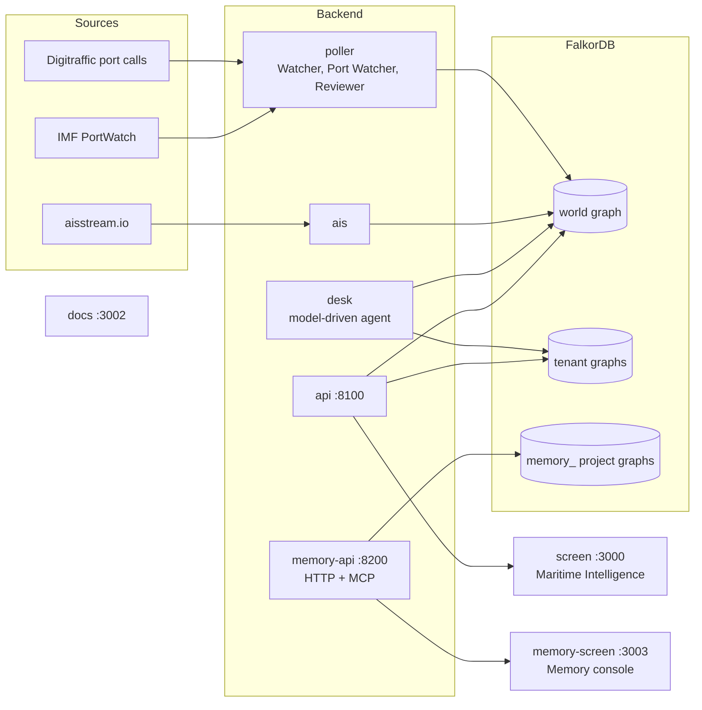
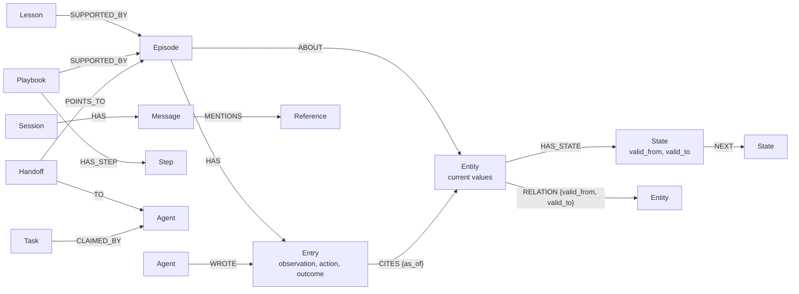
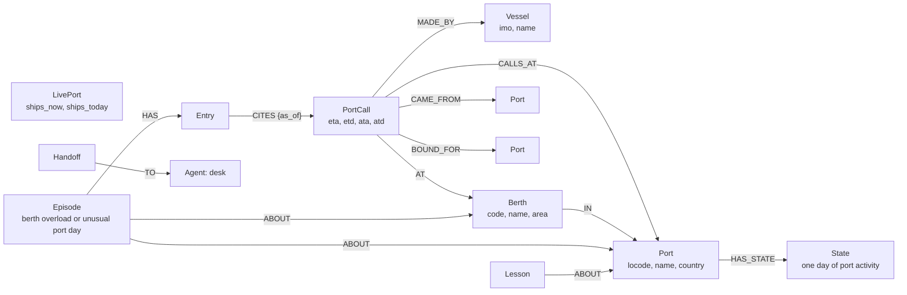

<p align="center">
  
</p>

# Lighthouse

Graph-native agent memory and a maritime operations console, built on [FalkorDB](https://www.falkordb.com/).

This repository holds two products:

| Product | What it is | Where |
| --- | --- | --- |
| **Lighthouse Memory** | A temporal memory library for AI agents (`pip install lighthouse-graph`), a hosted Memory API with an MCP server, a developer console, and documentation | `lighthouse-memory/`, `backend/app/memory_*`, `memory-site/`, `docs-site/`, `plugins/` |
| **Lighthouse Maritime Intelligence** | An operations console for ports and vessels. Agents watch live public shipping data, open cases with evidence, and learn from what happens. Built on Lighthouse Memory | `backend/`, `frontend/` |

Built for Graph Hacks (WeMakeDevs × FalkorDB), Track 01 (Agents That Act on Connected Data) and Track 02 (Agent Memory and Coordination).

## Contents

- [Architecture](#architecture)
- [Setup](#setup)
- [Graph data model](#graph-data-model)
- [Agents](#agents)
- [Data sources](#data-sources)
- [Measured results](#measured-results)
- [How it meets the hackathon tracks](#how-it-meets-the-hackathon-tracks)
- [Security](#security)
- [Deployment](#deployment)
- [Development](#development)
- [Repository layout](#repository-layout)
- [License](#license)

## Architecture



| Service | Port (localhost) | Role |
| --- | --- | --- |
| `falkordb` | 26379, Browser on 23000 | The database. Every service reads and writes here |
| `api` | 8100 | Maritime API: read routes for the console, cases, profiles, and the Desk |
| `poller` | | Reads the port call feed every few minutes and IMF PortWatch hourly, then runs the Watcher, Port Watcher, and Reviewer |
| `ais` | | Counts cargo ships and tankers in port at the 50 busiest ports from live AIS positions |
| `desk` | | The model-driven Desk agent, which uses graph tools over MCP |
| `memory-api` | 8200 | Lighthouse Memory service: project API keys, HTTP API, and MCP server at `/mcp` |
| `screen` | 3000 | Maritime Intelligence console |
| `memory-screen` | 3003 | Lighthouse Memory website and developer console |
| `docs` | 3002 | Lighthouse Memory documentation |

All ports are bound to `127.0.0.1`.

## Setup

### Prerequisites

- Docker with Compose ([Docker Desktop or Docker Engine](https://docs.docker.com/get-docker/))
- On Windows, WSL or Git Bash

No local Python or Node.js installation is needed to run the stack.

### Quick start

```bash
git clone https://github.com/MitudruDutta/lighthouse.git
cd lighthouse
./setup.sh
```

`setup.sh` creates `.env` from `.env.example` with private local credentials, optionally asks for a model API key, builds the images, starts every service, and waits until each is healthy. Then open:

| Site | URL |
| --- | --- |
| Maritime Intelligence console | http://localhost:3000 |
| Lighthouse Memory website and console | http://localhost:3003 |
| Lighthouse Memory documentation | http://localhost:3002 |
| Memory API reference (OpenAPI) | http://localhost:8200/docs |
| FalkorDB Browser | http://localhost:23000 |

Create an account at `/signup` on either site; the same account works on both. Public data imports start in the background.

| Command | Does |
| --- | --- |
| `./setup.sh` | Builds and starts the stack, or applies changes. Keeps settings and graph data |
| `./setup.sh --status` | Shows the running services |
| `./setup.sh --stop` | Stops the services and keeps the data |
| `./setup.sh --help` | Lists the options |

Build logs are written to `.lighthouse/setup.log`.

### Configuration

Settings live in `.env`. The defaults run everything locally; these are the ones you may want to set:

| Variable | Purpose |
| --- | --- |
| `AISSTREAM_API_KEY` | Live ship counts in port. Free key from [aisstream.io](https://aisstream.io) under API Keys. Without it, the global view uses IMF PortWatch alone |
| `LIGHTHOUSE_MODEL_PROVIDER`, `LIGHTHOUSE_MODEL`, and a provider key such as `ANTHROPIC_API_KEY` | The model for the Desk agent. Monitoring, imports, and rule-based agents work without one |
| `GOOGLE_CLIENT_ID`, `GOOGLE_CLIENT_SECRET` | Optional Google sign-in for both sites. Register `http://localhost:3000/api/auth/google/callback` and `http://localhost:3003/api/auth/google/callback` as redirect URIs |
| `FALKORDB_USERNAME`, `FALKORDB_PASSWORD` | Required for any database another machine can reach |
| `*_PORT` | Host ports, if the defaults are taken |

### Using Lighthouse Memory in your own project

```bash
pip install lighthouse-graph
docker run -p 6379:6379 -it --rm falkordb/falkordb:6.0.2
```

See [`lighthouse-memory/README.md`](lighthouse-memory/README.md) for the quick start and API, or connect an agent to the hosted service: create a project and an API key in the Memory console, then add the MCP server to Claude Code with the command shown on the console's **Agents & MCP** page, or install the Claude Code plugin in [`plugins/lighthouse-memory`](plugins/lighthouse-memory).

## Graph data model

Both products store everything in FalkorDB through the Lighthouse Memory library. The library defines a generic temporal model; each application declares its own kinds of entity on top of it.

### Core model (Lighthouse Memory)

Every entity keeps its full history. A change never overwrites: it adds a new `State` and closes the old one, and relations carry their own validity windows. Agent work is recorded as episodes of entries that cite their evidence.



| Node | Meaning |
| --- | --- |
| Entity (label of its kind, plus `Entity`) | A thing being remembered, holding its current values |
| `State` | One version of an entity's values, with `valid_from`, `valid_to`, and the writer in `by` |
| `Episode`, `Entry` | The ordered record of one event: what agents observed, forecast, and did, and the outcome |
| `Lesson` | What was learned from episodes that ended, weighted by evidence for and against it |
| `Playbook`, `Trigger`, `Step` | What to do when a situation comes again, versioned, drawn from episodes |
| `Task`, `Handoff`, `Agent` | Coordination: atomic claims, and work passed between agents by pointing at evidence |
| `Session`, `Message`, `Reference` | Conversation history per user, with mentions of entities by label and key |
| `WriteFailure` | A refused write, kept with its reason, so nothing is lost silently |

The full model, with every property and relationship, is in [`lighthouse-memory/README.md`](lighthouse-memory/README.md#graph-data-model).

### Graphs

| Graph | Contents |
| --- | --- |
| `world` | Shared maritime data: ports, vessels, berths, port calls, live counts, and the agents' episodes, lessons, playbooks, tasks, and handoffs |
| `tenant:<id>` | One per workspace: Desk conversations, the user's profile and watchlist, and case decisions |
| `memory_<project>` | One per Lighthouse Memory project, created by the Memory API |

A FalkorDB query never spans two graphs, so tenants and projects are isolated by construction.

### Maritime domain model (`world` graph)



| Kind | Key | Values | Relations |
| --- | --- | --- | --- |
| `PortCall` | `id` (feed port call id) | `eta`, `etd`, `ata`, `atd`, `area` | `MADE_BY` Vessel, `CALLS_AT` Port, `AT` Berth, `CAME_FROM` Port, `BOUND_FOR` Port |
| `Vessel` | `imo` | `name`, `mmsi`, `nationality`, `type_code` | |
| `Berth` | `port/area/berth` | `code`, `name`, `area`, `area_name` | `IN` Port |
| `Port` | `locode` (UN/LOCODE, or the PortWatch id) | `name`, `country`, `lat`, `lon`, and one `State` per day: `calls`, calls by ship type, `import_tonnes`, `export_tonnes` | |
| `LivePort` | `port` | `name`, `ships_now`, `ships_today`, `day` | |

How the model is used:

- **Every change is a version.** When a port call's expected arrival moves, the old `State` is closed and a new one opens, so the console can show what was expected at any moment. A berth change closes the `AT` edge and opens another.
- **A day of a port is a version of the port.** IMF PortWatch's daily figures are written as States of the `Port` node, so a port's history is its days, and the port a Finnish port call came from is the same node.
- **Cases are episodes.** When the Watcher sees a berth expected to hold more ships than it ever has, or the Port Watcher sees a port fall to half or rise to twice its usual calls, it opens an `Episode` about the berth or port. Each entry cites the port calls or port as they were at that time.
- **Learning links to evidence.** The Reviewer writes `Lesson` and `Playbook` nodes only from episodes that ended, and each links to them through `SUPPORTED_BY`.
- **Workspace data stays private.** Each user's watchlist (`OpsProfile`), case decisions (`OpsCase` with `OpsEvent` history), and Desk conversations live in that workspace's tenant graph and refer to world entities by key.

Example queries against the `world` graph:

```cypher
// Every expected arrival of one port call, oldest first
MATCH (:PortCall {id: $id})-[:HAS_STATE]->(s:State)
RETURN s.eta, s.valid_from, s.valid_to ORDER BY s.valid_from

// Port calls currently at a berth
MATCH (c:PortCall)-[r:AT]->(b:Berth {key: $berth})
WHERE r.valid_to IS NULL
RETURN c.id, c.eta

// The evidence behind a lesson
MATCH (l:Lesson {id: $lesson})-[:SUPPORTED_BY]->(e:Episode)-[:HAS]->(entry:Entry)
RETURN e.id, entry.seq, entry.type ORDER BY e.id, entry.seq
```

## Agents

| Agent | Role |
| --- | --- |
| **Watcher** | After each poll, finds berths where more port calls are expected than the berth has ever held. Opens an episode with the evidence, recalls lessons, follows a matching playbook, or raises a task and hands the case to the Desk. Rule-based |
| **Port Watcher** | After each new PortWatch day, compares every port with its median of the previous 28 days and opens an episode for unusual drops or surges. Rule-based |
| **Reviewer** | Reads episodes that ended and writes lessons and playbooks once three episodes agree. Switches a playbook off after three failures in a row |
| **Desk** | Answers questions in the console using typed graph tools over MCP, keeps conversation history per workspace, and records its assessments. Requires a configured model |

The MCP server (`backend/app/mcp_server.py`) offers 20 typed tools: 17 read questions (lookups at any time, version history, multi-hop connections, PageRank, connected incidents, overloads, episodes, lessons, playbooks) and 3 additions (an entry, a task, a handoff). No tool accepts a raw query, and none deletes.

## Data sources

| Source | Contents | Terms |
| --- | --- | --- |
| [Digitraffic port calls](https://meri.digitraffic.fi/api/port-call/v1/port-calls) (Fintraffic, Finland) | Port calls at Finnish ports: expected and actual times, berth, previous and next port | CC BY 4.0, "Source: Fintraffic / digitraffic.fi" |
| [Digitraffic vessel details](https://meri.digitraffic.fi/api/port-call/v1/vessel-details) | Vessel name, IMO number, type | CC BY 4.0 |
| [IMF PortWatch](https://portwatch.imf.org/) | Daily port calls by ship type and estimated trade tonnes for 2,065 ports in 180 countries, published with a delay of about a week | IMF terms; commercial reuse needs the IMF's permission. "Source: IMF PortWatch" |
| [aisstream.io](https://aisstream.io) | Live AIS positions and ship types around the 50 busiest ports | aisstream.io terms; free API key |

Personal fields in the port call feed, such as ship master and agent names, are dropped on load.

## Measured results

Every number comes from the running system and can be reproduced: `cd backend && uv run python -m app.measure <name>` runs one measure against the Compose FalkorDB and writes the result to `measurements/<name>.json`.

| Claim | Result |
| --- | --- |
| Writing needs no LLM | 0 model calls for 300 port calls. One write: 5.2 ms median, 7.8 ms at the 95th percentile. 1,168 port calls per second in a batch |
| History is exact | 7,711 changes across 500 entities read back with 0 wrong |
| Late data is never placed wrong | Shuffled input: every row that could not be placed exactly was refused and recorded, none silently wrong |
| Agents never double-claim | 16 agents racing for 500 tasks: 0 tasks won twice |
| Tenants are isolated | 0 nodes, search results, or versions visible across tenant graphs |
| Memory survives a restart | Data written before a FalkorDB restart is read after it |
| Graph algorithms are fast | On 100,000 entities and 550,000 relations: 77 ms for connected groups, 64 ms for PageRank, 0.5 ms for a four-step connection; repeated questions 0.2 to 0.3 ms |

One result went against us, and is published as measured: replaying 400 days of PortWatch data, lessons did not improve the forecast of whether an unusual port day returns to normal within three days (97.8% with and without memory), because almost every spell does.

## How it meets the hackathon tracks

| Track focus | In Lighthouse |
| --- | --- |
| Episodic, semantic, and procedural memory | `Episode`, `Lesson`, `Playbook`, and `promote()` between them |
| Persistent conversation history | `Session` and `Message` chains per tenant, mentioning the vessels and ports they discuss |
| Shared state and handoffs | Atomic `Task` claims with leases and dependencies; `Handoff` pointing at evidence |
| Separate memory per user or tenant | One FalkorDB graph per tenant, plus the shared world graph |
| Multi-hop reasoning | `connection()` (shortest path), `similar()`, `pointing_at()`, `related()` at any point in time |
| Graph algorithms as agent tools | PageRank (`algo.pageRank`), connected incidents (`algo.WCC`), shortest paths, exposed as MCP tools |
| Tool selection through MCP | 20 typed tools used by the model-driven Desk |
| Actions based on the graph | The Watcher and Port Watcher open cases, follow playbooks, raise tasks, and hand off |
| Explainable results | Every entry cites its evidence as it was at the time; every connection step states its relation and validity |

## Security

- **Identity comes from the server.** Writer names, task owners, and handoff receivers are set from the authenticated user or key, never from a model's output.
- **Agent tools are typed and additive.** No tool accepts a query or deletes data.
- **Input is bounded.** The library rejects query text, invalid bytes, oversized or deeply nested values, and future-dated rows; each attack is a test in `lighthouse-memory/tests/test_attacks.py`.
- **Accounts are protected.** Sessions are `HttpOnly` cookies, mutations are origin-checked, and failed sign-ins are rate-limited per address and per account.
- **The database is private.** FalkorDB binds to `127.0.0.1`. Set `FALKORDB_USERNAME` and `FALKORDB_PASSWORD`, and use TLS, for any database another machine can reach.
- **Errors stay on the server.** Users see safe messages; diagnostics go to server logs.

## Deployment

`deploy/aws/` runs the stack on one EC2 host with the same Compose file, images from ECR, and Caddy serving HTTPS for the app, Memory site, docs, and Memory API. FalkorDB and the operations API get no public port, and secrets are kept in SSM Parameter Store.

```bash
AWS=aws PROFILE=lighthouse REGION=ap-south-1 deploy/aws/provision.sh   # first deployment
AWS=aws PROFILE=lighthouse REGION=ap-south-1 deploy/aws/update.sh      # later releases
```

## Development

Requires Docker, [`uv`](https://docs.astral.sh/uv/), and [`bun`](https://bun.sh/).

```bash
cp .env.example .env
docker compose up -d falkordb            # FalkorDB on 127.0.0.1:26379

cd lighthouse-memory && uv sync && uv run pytest     # the library
cd ../backend && uv sync && uv run pytest            # the services
uv run python -m app.poller --once                   # one import of the live feeds into the world graph
uv run uvicorn app.main:app --port 8100              # the maritime API

cd ../frontend && bun install && bun run dev         # the console on http://localhost:3000
```

`mutation/mutate.py` plants deliberate bugs in copies of the library and the backend; the test suites must catch every one.

## Repository layout

| Path | Contents |
| --- | --- |
| `lighthouse-memory/` | The Lighthouse Memory library, published on PyPI as `lighthouse-graph`. Generic: no code for any one product |
| `backend/` | FastAPI services: the maritime API, feed importers, agents, MCP server, and the Lighthouse Memory API |
| `frontend/` | Maritime Intelligence console (Next.js) |
| `memory-site/` | Lighthouse Memory website and developer console (Next.js) |
| `docs-site/` | Lighthouse Memory documentation (Next.js) |
| `plugins/` | The Claude Code plugin for Lighthouse Memory |
| `deploy/` | AWS deployment scripts |
| `mutation/` | Mutation testing for both suites |
| `measurements/` | Results of the measures above |

## License

Lighthouse Memory (`lighthouse-memory/`) is released under the [Apache License 2.0](lighthouse-memory/LICENSE).
