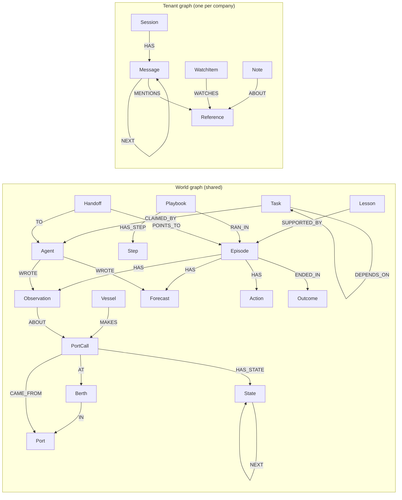

# Lighthouse

Agent memory on FalkorDB, where the graph does the remembering.

Lighthouse is a memory layer for a crew of agents that work on live, structured data. The agents share one memory, hand work to each other through it, and get better as it fills. The first product built on Lighthouse is a port desk: agents that watch real ship arrivals and learn from what happens.

**Status: the memory library, automatic public-feed imports, the Watcher, Port Watcher and Reviewer, the model-driven Desk over MCP, connected investigations, data-quality reporting, the operations workspace, and an independent documentation site are implemented. Model-based investigations require a configured, reachable service; operational rules and imports work without a model.**
Entry for Graph Hacks (WeMakeDevs x FalkorDB), in two tracks: Track 01, Agents That Act on Connected Data, and Track 02, Agent Memory and Coordination.

## Run locally

Install [Docker Desktop or Docker Engine with Compose](https://docs.docker.com/get-docker/), open a terminal in this folder, and run:

```bash
./setup.sh
```

Setup creates private local credentials, optionally asks for your model API key, builds the eight services, and checks readiness. No Python or Node installation is needed. On Windows, use WSL or Git Bash.

Open Lighthouse Memory at **http://localhost:3003**, the operations app at **http://localhost:3000** and the independent docs at **http://localhost:3002**. Public data imports continue in the background. Monitoring works without a model key; the Desk assistant needs a configured provider.

Run setup again to apply changes; it preserves your settings and graph data. Use `./setup.sh --status` to check services, `./setup.sh --stop` to stop them, or `./setup.sh --help` for options. Build details stay in `.lighthouse/setup.log`. The older `./start.sh` command still works.

## Lighthouse Memory developer preview

The independent Memory website includes accounts, private workspaces, projects, scoped expiring API keys, a memory explorer with version history and connections, usage records, and profile preferences. Each project owns a separate FalkorDB graph. Account and key metadata persist in the `memory_control` Docker volume; graph data persist in `falkordb_data`.

Create an account at http://localhost:3003/signup, create a project, and issue a key under **API keys**. Use the dashboard’s **Connect** example against http://localhost:8200. Project keys authenticate the HTTP service; the Python library connects directly to FalkorDB and requires no Lighthouse API key. The HTTP service exposes structured memory writes, search, history, connection paths, and agent coordination: episodes, task claims, and handoffs, with each project key acting as the agent it is named after. The Python library adds learning (lessons, playbooks, promotion) and conversations.

This is a local developer preview. Billing, managed hosting, email verification, password recovery, and team invitations are not active. Do not expose this preview directly to the public internet. The API reference is available at http://localhost:8200/docs. Diagnostics remain in server logs; customers receive safe messages.

## Layout

| Path | Contents |
| --- | --- |
| `lighthouse-memory/` | The memory library, Python package `lighthouse`, published on PyPI as `lighthouse-graph`. Generic: it has no code for ports or for any other product. See its README for the model, the write rule, and the API. |
| `backend/` | The port desk. `app/portcalls.py` maps the port call feed to library rows. `app/berths.py` works out what a berth has held and where more is expected. `app/watcher.py` is the agent that acts on that. `app/reviewer.py` turns overloads that ended into lessons and playbooks. `app/mcp_server.py` offers the graph to agents as tools over MCP. `app/portwatch.py` reads the ports of the world from IMF PortWatch. `app/portwatcher.py` is the agent that acts on unusual days at them. `app/poller.py` reads the feed every few minutes and runs the two agents after each read, and PortWatch once an hour. `app/web.py` reads public JSON without trusting it. `app/api.py` serves the screen: read-only routes under `/api`. |
| `frontend/` | The screen of the port desk, in Next.js: it reads the API from the server and writes nothing. An overview with a map of the ports of the world, the ports of a country and the days of one port, the berth board of Finland, the episodes with their evidence, and what was learned. |
| `memory-site/` | Independent Lighthouse Memory landing page and authenticated developer console, served on port 3003. |
| `docs-site/` | Memory-only documentation on port 3002, using the Fumadocs notebook shell adapted from Rehearsal, with Lighthouse’s warm product palette. |
| `mutation/` | The mutation check: deliberate bugs planted in copies of both projects, each of which the tests must catch. |

Built and tested so far:

- Entities keep every version of their values, with validity windows (items 1 to 3 below). A row that arrives late goes into the history at its time. A partial update changes some values or relations and keeps the rest, and never writes over a change it did not see. A version can point at the entry it came from, as its evidence.
- Relations between entities have their own validity windows.
- Episodes: entries in one order, each with its writer and the evidence it cites (the episodic part of item 4, and item 7). The Watcher writes them.
- Lessons and playbooks, in the library (the rest of item 4, and the stored half of items 5 and 9). A lesson rests on episodes that ended and has a weight from the evidence for and against it and from where it helped. A playbook needs a number of such episodes, is replaced by a next version and never changed, can be switched off, and switches itself off after failures in a row. The job that turns what repeats into lessons and playbooks is in the library too (`promote`); what counts as a repeat is a rule the application passes in.
- A task claim is one atomic query; a task can wait for others, a claim can run out after a lease, and an owner can release a task. A handoff points at the record and is accepted once by its receiver (item 6).
- Recall by the graph and by text: what points at an entity, the entities that share its relation targets with the reason for each, and full-text search on the properties a kind names. On the live feed: a vessel is found by a word of its name, and the port calls most like a given one are listed with the berth, ports, and vessel they share.
- Recall by meaning, in the library only: vectors from a function the application passes in, in a FalkorDB vector index with `efRuntime` 100, and one ranking from the three ways of recall. The port desk has no embedding model yet, so it does not use this.
- Graph algorithms that run inside FalkorDB (item 10): the sets of things that relations join, such as the episodes about the same entities; entities by PageRank; entities by the shortest paths that run through them; and the shortest chain of relations between two things, with what still holds at each step. An answer is kept until the graph grows where the question reads it. On 100,000 entities and 550,000 relations on one laptop, the first answer took 77 ms for the sets, 64 ms for the rank, 233 ms for the paths counted from 32 entities, and 0.5 ms for a chain of four steps; the same question again took 0.2 to 0.3 ms. Three runs. On port call data: the port with the most port calls, the berths between port calls and their port, and how two ships are connected through a port.
- Conversation history, in the library: sessions that belong to one user, messages in one order, mentions of things by name so that a message in the graph of a tenant can name a ship in the shared graph, search by words, a summary for a long session, and erasure of a session or of everything a user said. A session of another user cannot be reached by its id. The Desk uses tenant-scoped sessions and relevant conversation recall.
- Search in what was true earlier and in what agents wrote: the words of past versions, and the words and meaning of entries. FalkorDB's full-text index does not split words at a line break, so the library indexes the words alone.
- Graph algorithms at one point in time: the sets, the ranks, the paths through, and the shortest chain over the relations that held then.
- The free-text path, in the library: a function the application passes in reads entries and gives rows, which are written by the write rule with the entry as their evidence.
- One graph per tenant (item 8).
- **Berth overloads, found from the graph's own history.** The feed does not say how many ships fit at a berth, and some berth codes stand for a whole harbour. So the port desk takes what a berth holds from what was alongside together, and flags a berth only when more port calls are expected at one time than it ever held. On a sample of the feed, among 246 port calls with a berth, 43 pairs of port calls of different vessels that had not left overlapped at one berth code. This rule flagged 11 berths. Where the graph had seen four ships together at one berth code, it flagged the fifth; where it had seen six, it flagged nothing. The rule reads all 119 berths in 3 ms.
- **The Watcher, an agent that acts.** After a poll it opens an episode for each new overload, writes what it sees with the berth and the port calls as evidence, and does what memory says: it writes a lesson about the berth into the episode, follows a playbook that fits and records the run, or, with no playbook, raises a task and hands the episode to the desk. It adds an observation when the picture changes, and closes the episode with what became of each port call and whether the berth held them all after all. It decides by rule, not by a model. One live run: 237 port calls stored and watched in 1.5 s, 7 episodes opened.
- **The Reviewer, which learns.** After the Watcher it reads every overload episode that ended. Whether the berth took them all becomes a lesson about the berth, for or against. A port call that was moved to another berth becomes a playbook: at the next overload of that berth, propose the other one. A playbook that ran is judged right when a port call went where it proposed. Each needs three episodes that agree before it is written, and three failures in a row switch a playbook off. At the next overload, the Watcher recalls the lesson, follows the playbook, and hands its proposal to the desk. One live poll gave nothing to learn yet: an overload must end first, which takes hours of polls.
- **Ports of the world.** Every day of 2,065 ports in 180 countries from IMF PortWatch: port calls by ship type, and tonnes unloaded and loaded. A day of a port is a version of the port, so its history is its days, and the port that a Finnish port call came from or is bound for is the same node. Thirty days load in under a minute.
- **The Port Watcher, an agent for the world.** For each new day it compares every port with the median of its 28 days before: a port that usually has at least 6 port calls a day and fell to half of that, or rose to twice that, is an episode. On the last day read, about 2% of ports were unusual, such as Piraeus at 6 port calls against a usual 13. The episode ends when the port is back to usual, and the Reviewer learns from it.
- **A live desk.** The poller reads the feed every few minutes and runs the Watcher and the Reviewer after each read; a failed read is logged and the next comes on time. Read-only API routes give the screen the berth board, the episodes with their evidence, lessons, playbooks, a port call or a vessel at any time, search by name now and earlier, and the chain between two things now or at a time.
- **A screen.** A map of every port with a place, as large as its port calls on the last day, the unusual ones in red; the ports that are unusual now, with their port calls against the usual; the Finnish berths where more ships are expected than ever held; each episode in order, each entry with its evidence as it was then; and the lessons. Every page reads the running graph.
- **Tools for agents over MCP.** 20 typed tools: 17 questions (find, look at any time, versions, what points at a thing, what is alike, how two things are connected, PageRank, incidents, overloads, episodes, lessons, playbooks) and 3 additions to the record (an entry, a task, a handoff). No tool takes a query and none deletes. The name on every write comes from the server. Over a real stdio session against the live graph, a tool call took 2 to 5 ms.
- The live port call feed is stored through the library: 273 port calls in 241 ms on one laptop, 0 LLM calls, 0 personal fields in the graph. One run.

## Why

Most agent memory tools are built for conversation text. Each stored memory passes through LLM calls, and recall is a text or vector match. That is slow and costly for a stream of structured events, and it leaves the graph unused as a graph.

Lighthouse takes the other path:

- **Writing a memory needs no LLM.** A structured event becomes nodes and edges through one query.
- **Recall is a traversal.** From a ship to its past port calls, to the berth, to what happened next.
- **Time rules decide what is still true.** No model guesses which old fact a new fact replaces.
- **Agents coordinate inside the graph.** Tasks, claims, and handoffs are nodes and edges.

## What Lighthouse does

1. **Stores structured events without an LLM.** LLMs are used only for free text, and never on the write path.
2. **Keeps history by rule.** A fact has a subject, a property, and a validity window. A new value for the same subject and property closes the old one. Nothing is overwritten, attributes included.
3. **Never loses a write silently.** Each write returns what was stored. A failed write is stored as a failure record.
4. **Holds three kinds of memory as graph structures.**
   - Episodic: what happened, in order, for one event.
   - Semantic: lessons, each linked to the episodes that support it.
   - Procedural: playbooks with a trigger, steps, and a success count.
5. **Promotes memory in the background.** Repeated episodes become a lesson. Repeated successful actions become a playbook. A playbook needs a minimum number of supporting episodes, has a version, and can be switched off.
6. **Coordinates agents.** An agent claims a task with one atomic query, so two agents cannot own the same task. A handoff points to evidence in the graph; it does not copy text.
7. **Records who wrote what, and from which evidence.**
8. **Separates tenants.** One shared world graph, one graph per tenant.
9. **Ranks by use and outcome.** A memory that led to a correct result ranks higher. Unused memory fades.
10. **Runs graph algorithms inside FalkorDB** to group events into incidents, find bottlenecks, and explain why a memory is relevant.

## Memory model sketch

A sketch to explore. The built part differs from it in three ways: every relation edge starts at the entity that the row describes (`PortCall -MADE_BY-> Vessel`, not `Vessel -MAKES-> PortCall`); the berth and the ports are edges of the port call with their own validity windows, not edges of a `State`; and a `State` holds only values. An episode has entries of one label, `Entry`, with a `type` (observation, forecast, action, outcome), not one label for each. A `Handoff` points at entries, episodes, and entities, not only at an episode. A `Playbook` has a `Trigger` node besides its `Step` nodes, and a new version `REPLACES` the one before. Tasks beyond the claim and the tenant graph are still a sketch.



Points the model has to hold:

- A `State` is one version of an entity's changing values, such as the expected arrival time of a port call or the name of a vessel. A change adds a new `State` linked to the previous one. The entity node shows the current values.
- A relation, such as the berth of a port call, is an edge with a validity window. A change closes the edge and opens a new one.
- An `Episode` is the chain for one event: observations, forecasts, actions, and the outcome that reality delivered.
- A `Lesson` and a `Playbook` always link to the episodes behind them. A claim with no evidence is not stored.
- A `Reference` in a tenant graph holds the key of a world entity (IMO number, port call identifier). A FalkorDB query cannot span two graphs, so the application joins by key.
- Every node written by an agent records the agent and the time.

## How this meets Track 02

| Track 02 key focus | In Lighthouse |
| --- | --- |
| Episodic, semantic, and procedural memory | `Episode`, `Lesson`, `Playbook`, and `promote()` between them; the Reviewer is the port desk's rule for it |
| Persistent conversation history | `Session` and `Message` chains per tenant, linked to the ships and port calls they mention |
| Shared state and handoffs between agents | `Task`, atomic claim, `Handoff` pointing to evidence |
| High-concurrency reads and writes | Feed writer, agents, and screen use the graph together; numbers measured and published |
| Separate memory per user or tenant | One FalkorDB graph per tenant, plus the shared world graph |

## How this meets Track 01

Track 01 asks for an agent that uses the graph to decide and act. One agent does that by rule, and the tools for an agent that is driven by a model are served over MCP. The Desk selects fixed graph tools through MCP and records its assessment and tool trace. A reachable configured model is required.

| Track 01 key focus | In Lighthouse | State |
| --- | --- | --- |
| Multi-hop reasoning | `connection()` gives the shortest chain of relations between two things; `similar()` goes two hops through what entities share; `pointing_at()` and `related()` go one hop at any time in the past | Built, and offered as the tools `connected`, `alike`, `pointing`, `look` |
| Graph queries and algorithms as agent tools | `important()` (`algo.pageRank`) as `central`, `groups()` (`algo.WCC`) as `incidents`, `connection()` (`shortestPath`) as `connected`, and the berth load rule as `overloaded` | Built. `between()` is in the library and not offered as a tool: on this graph every score is 0 unless the relations are narrowed |
| Tool selection through MCP | `app/mcp_server.py`: 20 typed tools, with what each one is for | Built and exercised by the model-driven Desk through MCP sessions |
| Actions based on what the graph shows | The Watcher: sees an overload, opens an episode, recalls lessons, follows a playbook or hands over to the desk, and closes the episode when the overload is gone | Built, by rule. Through the tools a model can add entries, tasks, and handoffs |
| Explainable results | Each observation says what the berth held, which port calls showed that, and which are expected, and cites them as they were then; each step of `connection()` says which relation, which way, whether it holds, and since when | Built |

## FalkorDB features the design depends on

| Feature | Use |
| --- | --- |
| Many graphs in one instance | Tenant isolation without filters |
| One write at a time per graph, and a single query is atomic | Task claims that cannot be won twice |
| Graph algorithms (`algo.WCC`, `algo.pageRank`, `algo.betweenness`) and `shortestPath` | Group events into incidents, find bottlenecks, explain how two things are connected. `algo.SPpaths` is not used: for the fewest steps it took 240 to 2,500 ms where `shortestPath` took 1 ms, on 100,000 nodes |
| Variable-length traversal | Recall of similar past events |
| Vector index | Similar-event search where a pattern match is not enough |
| Full-text index | Find a ship or port by name |
| Native time values with range indexes | Validity windows |
| MCP server | Agents reach graph tools through MCP |
| FalkorDB Browser | Show the memory graph in the demo |

Checked on a throwaway container, with scripts that are not in this repository: two writes to the same graph took 2.02 times one write, two writes to two graphs took 1.38 times; a point read took 10.8 ms during a write against 9.6 ms idle; an exact vector scan over 20,000 nodes at 1,024 dimensions took 13 to 14 ms, and the vector index answered in 1.2 ms with full recall on synthetic clustered vectors at `efRuntime` 100. The default `efRuntime` of 10 gave 0.85 recall.

Limits the design works around: no multi-query transactions; no query across two graphs; maps and nulls cannot be stored as properties; the FalkorDB Cloud free tier has no persistence.

The server crashed once: a segmentation fault in Redis 8.10.2 with the graph module of the pinned image, while the mutation check and two runs of the test suites used it at the same time. It did not happen again in three runs of two suites at once, nor when each planted bug near that moment ran alone. The cause is not known. The Compose file now restarts the server, and the mutation check runs with nothing else on the database.

## The main product: port desk

Working name. A crew of four agents on one Lighthouse memory.

| Agent | Job |
| --- | --- |
| Watcher | Built. After each poll, finds berths where more port calls are expected than the berth ever held, and acts on what memory says |
| Port Watcher | Built. After each new day from PortWatch, finds ports of the world whose port calls fell to half the usual or rose to twice the usual, opens an episode with the port as evidence, recalls what was learned about the port, and hands it to the desk |
| Desk | Built. Talks to the user over the graph's MCP tools, remembers past sessions, keeps the watch list. Needs a configured model |
| Reviewer | Built for overloads and ports: writes lessons and playbooks from overloads that ended, judges the playbooks that ran, and learns per port whether a quiet or busy spell passes within three days |

A Forecaster that predicts lateness is not planned. The feed's final expected arrival time already has a median error of 0 minutes (see [What is measured](#what-is-measured)), so a forecast would have little to add.

### Data

Checked by hand. No key and no login for any of it.

| Source | Contents | Access | Terms |
| --- | --- | --- | --- |
| Digitraffic port calls (Fintraffic, Finland) | 270 port calls updated in 24 hours across 28 ports; 148 with both expected and actual arrival time; berth, previous port, next port | `https://meri.digitraffic.fi/api/port-call/v1/port-calls` | CC BY 4.0; credit "Fintraffic / digitraffic.fi" |
| Digitraffic ship positions | 890 ships live | `https://meri.digitraffic.fi/api/ais/v1/locations`, also MQTT | CC BY 4.0 |
| Digitraffic vessel details | Name, IMO number, type, dimensions | `https://meri.digitraffic.fi/api/port-call/v1/vessel-details` | CC BY 4.0 |
| IMF PortWatch | Daily port calls by ship type and estimated import and export tonnes, for 2,065 ports in 180 countries (Asia and Pacific 777, Europe 564, North America 291, South America 210, Africa 195; India 37), some days behind; 1,480 ports carry a UN/LOCODE | ArcGIS feature service `services9.arcgis.com/weJ1QsnbMYJlCHdG`, `Daily_Ports_Data` and `PortWatch_ports_database` | IMF terms: commercial reuse of IMF data needs the IMF's permission (copyright@imf.org); credited as "Source: IMF PortWatch" |

The port call feed carries ship master and agent names. Those fields are personal data and are dropped on load.

The live part covers Finnish ports only. A hundred foreign ports appear as previous or next port.

## What is measured

Every claim comes from the running system: `cd backend && uv run python -m app.measure <name>` runs one measure against the FalkorDB of `docker compose up -d` and writes its result, with the commit it ran on, to `measurements/<name>.json`. Each one writes to throwaway graphs of its own. The numbers below are from one laptop, 2026-10-17, in a Linux container under WSL.

| Claim | Measure | Result |
| --- | --- | --- |
| Writing a memory needs no LLM | `writes`: the live Finnish port call feed, one port call at a time, counting the model calls made | 0 LLM calls for 288 port calls. One port call: 7.7 ms at the 50th percentile, 12.4 ms at the 95th. 776 port calls a second in one batch. |
| History is exact | `history`: 500 entities, 7,711 changes, written once in time order and once shuffled so that rows arrive late | In order: 7,711 facts read back, 0 wrong. Shuffled: 2,271 late rows fell inside a State that held again after them; each was refused as `stale` and kept as a WriteFailure. 829 facts are wrong as a result, and every one of them holds a refused row: none is wrong silently. A `stale` failure keeps the refused values but not the row's time, so two such rows of one entity with the same values count on one node. |
| Memory survives a restart | `restart`, then `docker compose restart falkordb`, then `restart --check` | The mark written before the restart is read after it. FalkorDB keeps an append-only file and has two minutes to stop: before both, a stop that cut the last snapshot short lost what came after it. |
| Agents never double-claim | `claims`: 16 agents on their own connections race for 500 tasks | 500 claims won, 0 tasks won twice, 0 tasks with two claims |
| Tenants are isolated | `tenants`: 200 rows in one tenant's graph, read from another's | 0 nodes, 0 search results, 0 versions seen |
| Memory helps | `memory`: MEMORY_RESULT_PENDING | MEMORY_RESULT_PENDING |

Not claimed in advance: that memory improves arrival forecasts. When it was checked, the feed's final expected arrival time already had a median error of 0 minutes, with most arrivals within one hour.

## Hackathon notes

- **Original work.** Nothing is copied from the team's earlier Plimsoll project. If a general-purpose utility is carried over later, it is listed here.
- **Built before the event.** `lighthouse-memory/` is the team's own memory library, a separate project; the organisers confirmed it may be used. The port desk was started on it before the event as well: the project scaffold, the feed ingest, the berth load rule, the Watcher, the Reviewer, the MCP server, and the mutation check.
- **AI assistance.** Claude Code was used for the research, these notes, the memory model sketch, and as a coding assistant. The team reviews, tests, and can explain every query, the graph model, and the architecture.
- **Data.** Public open data under CC BY 4.0. No private, login-protected, or paywalled data. Personal fields are dropped.


## Open questions

- Where FalkorDB runs with a disk for the live deployment.
- Which LLM provider, and whether an embedding model is needed from the start.
- Which model drives the Desk by default. `.env.example` names `deepseek-v4.1-flash` on Ollama's cloud, and nine providers are supported, but no key is set, so the Desk answers only once one is added.
- Whether a berth overload is the right thing to act on. It is what the feed shows; a planner at a port has not been asked.
- Written permission from the IMF before PortWatch data is used commercially.
- Live, ship-by-ship data outside Finland. AIS streams with wide coverage exist; their coverage near Indian ports and their terms are not checked yet.
- Name and domain. "Lighthouse" is a working name and a crowded one: Google's web audit tool owns the `lighthouse` npm package and most search results.

## Security

The library was attacked with query text in every input, bytes the database cannot parse, values too deep or too large to print, oversized rows, and rows dated in the future. No input changed a query. Four attacks did damage before they were closed: one NUL byte in one value made the database refuse a whole batch; one row with 20,000 relation targets held the write lock of the graph for 227 seconds; one row dated in the year 9999 froze its entity for good; and a deep value crashed the code that reports a refused write. Each is now a test in `lighthouse-memory/tests/test_attacks.py`. The limits and the trust model are in the library README.

What the library does not do, and the application must:

- **It does not know who is calling.** `by`, the agent of a task, and the receiver of a handoff are names the caller gives. Set them in server code from an authenticated identity. Never take them from a model's output or from a user's message.
- **It does not decide who may ask a heavy question.** FalkorDB cannot stop a graph algorithm while it runs, and a read holds back the writers of the graph. The library bounds the cost of each call. Still, do not let a model or a user choose the arguments of `groups`, `important`, or `between` without a limit on how often they call.
- **The tools for agents take no query and delete nothing.** `app/mcp_server.py` offers typed questions and three kinds of addition. The name of a vessel comes from a public feed, and a model can be talked into things by such text. So the worst a model can do through these tools is ask more questions and add entries, tasks, and handoffs under the name the server gave it. Erasure of conversations is not offered as a tool.
- **It does not protect the database.** The Compose file binds FalkorDB to 127.0.0.1 and sets no password. For any database that another machine can reach, set `FALKORDB_USERNAME` and `FALKORDB_PASSWORD`, and use TLS.
- **It does not limit how often a caller writes.** Each call is bounded; the number of calls is not.

## Product workspace and documentation

The operations workspace runs at **http://localhost:3000**. Sign in with your Lighthouse account, or create one at `/signup`; the same credentials work in Lighthouse Memory. The **Profile** tab saves display name, timezone, default queue, and followed ports and vessels to your private workspace graph. Investigations support ownership, proposed plans, approvals, outcomes, and a persistent decision history; source signals remain separate from human resolution. Documentation is an independent Next.js site at **http://localhost:3002**, with its own build and Docker service in `docs-site/`. Old `/docs` links redirect there.

- **Agent control room** (`/agents`) exposes real task claims, handoffs, assessments, native FalkorDB PageRank, and connected incident groups.
- **Investigate** (`/investigate`) visualizes bounded entity neighbourhoods and traces shortest known chains with direction and current/historical status.
- **Data sources** (`/sources`) separates source publication delay from update availability and reports missing coverage and accepted observations. Backend diagnostics are available only through the separately authenticated operator API and local logs.
- The Desk receives an additional fixed `data_quality` MCP tool to check coverage before making claims. Model-based investigations require a configured model; the control room shows worker health separately from configuration.
- PortWatch saves a checkpoint after each complete day and stops at an empty or rejected day. Tests cover interruptions, partial writes, retries, graph bounds, query input safety, and missing observations.

Google sign-in uses one OAuth **Web application** client for both products. Set `GOOGLE_CLIENT_ID` and `GOOGLE_CLIENT_SECRET` in `.env`; register `http://localhost:3000/api/auth/google/callback` and `http://localhost:3003/api/auth/google/callback` as authorized redirect URIs. JavaScript origins are not required for this server-side flow. Existing password accounts can connect their matching Google identity from **Profile** (operations) or **Settings** (Memory). OAuth checks state, PKCE, nonce, issuer, audience, expiry, and verified email; identities link only after authenticating the existing account. When domains change, update `LIGHTHOUSE_APP_URL`, `MEMORY_SITE_URL`, and Google’s redirect URI list together.

Use `scripts/capture_ui.py` to check the running sites and regenerate screenshots in `screenshots/ui-review/`, which is not committed. It needs Playwright: run `uv run --with playwright playwright install chromium` once, then `uv run --with playwright python scripts/capture_ui.py`. Pass `--storage-state` with a saved sign-in to capture the signed-in pages.

Sign-in, registration, and Google sign-in are limited per browser address and, for failed logins, per email: ten failures in 15 minutes pause that account's logins whatever address they come from. The websites pass the browser's address to the APIs with `LIGHTHOUSE_PROXY_TOKEN`, which `./setup.sh` generates; without it every browser shares the website server's limit. Behind a reverse proxy, have it append the client to `X-Forwarded-For`.

## Local setup

Needs Docker, `uv`, and `bun`. Host ports are chosen to avoid 6379 and 8000.

```bash
cp .env.example .env
docker compose up -d                     # FalkorDB on 127.0.0.1:26379, Browser on 127.0.0.1:23000

cd lighthouse-memory
uv sync
uv run pytest                            # the memory library, against the running FalkorDB

cd ../backend
uv sync                                  # installs the library from ../lighthouse-memory
uv run pytest
uv run python -m app.poller --once      # one read of the live feed into the `world` graph, then the Watcher, the Reviewer, and PortWatch
uv run python -m app.poller             # the same every 5 minutes, until stopped
LIGHTHOUSE_AGENT=desk uv run python -m app.mcp_server   # the tools over MCP, on standard input and output
uv run uvicorn app.main:app --port 8100  # http://127.0.0.1:8100/readyz, and the routes in /docs

cd ../frontend
bun install
bun run dev                              # http://localhost:3000, reading the API on 127.0.0.1:8100 (LIGHTHOUSE_API names another)
```

`/readyz` returns 200 only when FalkorDB itself answers; a plain Redis on the same port gets 503.

An MCP client starts the tools itself. Its configuration names the command, the graph, and the agent that the writes are signed with:

```json
{
  "mcpServers": {
    "lighthouse-port-desk": {
      "command": "uv",
      "args": ["run", "--directory", "/path/to/lighthouse/backend", "python", "-m", "app.mcp_server"],
      "env": { "LIGHTHOUSE_GRAPH": "world", "LIGHTHOUSE_AGENT": "desk" }
    }
  }
}
```

The server uses version 1 of the MCP Python SDK (`mcp>=1.26,<2`). Version 2 renamed the classes it is written with.
