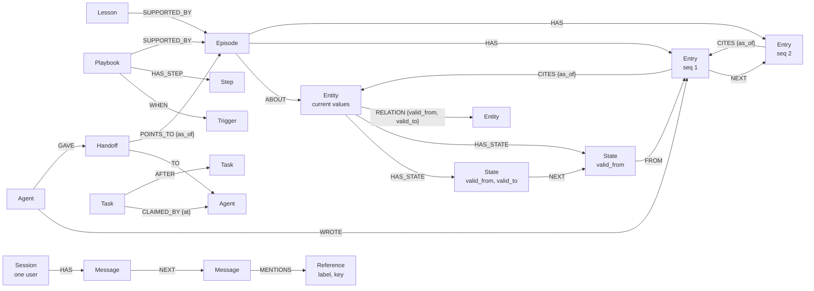

<p align="center">
  
</p>

# Lighthouse Memory

[](https://pypi.org/project/lighthouse-graph/)
[](https://pypi.org/project/lighthouse-graph/)
[](https://github.com/MitudruDutta/lighthouse/blob/main/lighthouse-memory/LICENSE)

Temporal, graph-native memory for AI agents, built on [FalkorDB](https://www.falkordb.com/).

Lighthouse Memory turns structured events into versioned facts by rule, with no LLM on the write path. Every earlier version is kept, every write returns a receipt, and agents recall by traversal, by words, or by meaning. Agents also coordinate through the same graph: atomic task claims, handoffs that point at evidence, and episodes that record what they saw and did.

The package is published on PyPI as `lighthouse-graph` and imported as `lighthouse`.

## Contents

- [Features](#features)
- [Requirements](#requirements)
- [Installation](#installation)
- [Quick start](#quick-start)
- [Example](#example)
- [Graph data model](#graph-data-model)
- [Write semantics](#write-semantics)
- [API overview](#api-overview)
- [Hosted API, MCP, and Claude Code](#hosted-api-mcp-and-claude-code)
- [Guarantees](#guarantees)
- [Security and limits](#security-and-limits)
- [Development](#development)
- [License](#license)

## Features

- **Versioned facts, by rule.** A row is the full picture of one entity at a time. A changed value adds a new version and closes the old one; nothing is overwritten. No model decides what a new fact replaces.
- **Time travel.** Read any entity or relation as it was at any moment (`as_of`, `related`), compare two times (`diff_between`), or lay rows over the graph without writing them (`what_if`).
- **Late and partial data.** Rows that arrive out of order are placed in history at their own time. `update()` changes some values and keeps the rest, and never writes over a change it did not see.
- **Episodic, semantic, and procedural memory.** Episodes record what agents observed, forecast, and did, with cited evidence. Lessons and versioned playbooks are learned from episodes that ended, and always link to them.
- **Recall.** By traversal (`pointing_at`, `similar`), by words (full-text index), and by meaning (vector index, with an embedder you supply), fused into one ranking.
- **Graph algorithms in the database.** Connected groups (WCC), PageRank, betweenness, and shortest paths run inside FalkorDB, now or at a point in the past.
- **Multi-agent coordination.** Task claims are one atomic query, with dependencies and leases. Handoffs point at the record instead of copying it, and are accepted once.
- **Conversation memory.** Ordered sessions per user, mentions of entities, summaries for long sessions, and erasure of a session or a user.
- **Impact analysis.** Find everything that rested on a fact or an entry that turned out wrong, retract it without deleting it, and measure how far an agent's work held.
- **Auditable by design.** Every State, edge, and entry records who wrote it and when. A refused write is stored as a `WriteFailure` with its reason; nothing is lost silently.
- **Tenant isolation.** One FalkorDB graph per tenant, plus a shared graph.

## Requirements

- Python 3.12 or later
- FalkorDB 6.0.2: the version the test suite runs against
- One runtime dependency: the `falkordb` client (1.7.1 or later)

## Installation

```bash
pip install lighthouse-graph
# or
uv add lighthouse-graph
```

Start a local FalkorDB with Docker:

```bash
docker run -p 6379:6379 -p 3000:3000 -it --rm falkordb/falkordb:6.0.2
```

FalkorDB listens on port 6379, and FalkorDB Browser on http://localhost:3000. `--rm` discards the data when the container stops; for persistent data, see the [FalkorDB documentation](https://docs.falkordb.com/).

## Quick start

```python
from falkordb import FalkorDB
from lighthouse import Kind, ensure_schema, remember, history, as_of

DEVICE = Kind("Device", key="serial", text=("note",))

graph = FalkorDB(host="127.0.0.1", port=6379).select_graph("demo")
ensure_schema(graph, [DEVICE])  # once per graph, before the first write

remember(graph, DEVICE, by="inventory", rows=[
    {"key": "d1", "t": "2026-01-01T00:00:00Z", "values": {"status": "ok", "note": "pump room sensor"}},
])
remember(graph, DEVICE, by="inventory", rows=[
    {"key": "d1", "t": "2026-01-02T00:00:00Z", "values": {"status": "hot", "note": "pump room sensor"}},
])

history(graph, DEVICE, "d1")                          # both versions, oldest first
as_of(graph, DEVICE, "d1", "2026-01-01T12:00:00Z")    # the version that held then: status "ok"
```

The example below covers the whole surface. It runs as written against the FalkorDB of this repository's Compose file (port 26379), and `tests/test_readme.py` checks every result it prints.

## Example

```python
from falkordb import FalkorDB
from lighthouse import Kind, ensure_schema, remember, history, as_of, related
from lighthouse import open_episode, record, close_episode, episodes_about
from lighthouse import hand_off, accept, handoffs_for
from lighthouse import search, pointing_at
from lighthouse import learn, lessons_about, write_playbook, playbooks_for
from lighthouse import groups, connection
from lighthouse import say, messages, said_about

ROOM = Kind("Room", key="code")
TEAM = Kind("Team", key="name")
DEVICE = Kind(
    "Device",
    key="serial",
    times=("last_seen",),
    text=("note",),
    relations={"LOCATED_IN": ROOM, "USED_BY": TEAM},
)

graph = FalkorDB(host="127.0.0.1", port=26379).select_graph("world")
ensure_schema(graph, [DEVICE])  # once, before the first write

remember(
    graph,
    DEVICE,
    by="inventory",
    rows=[
        {
            "key": "d1",
            "t": "2026-01-01T00:00:00Z",
            "values": {
                "status": "ok",
                "note": "pump room sensor",
                "last_seen": "2026-01-01T00:00:00Z",
            },
            "relations": {"LOCATED_IN": "r1", "USED_BY": ["red", "blue"]},
        }
    ],
)
# [{"key": "d1", "status": "created"}]

remember(
    graph,
    DEVICE,
    by="inventory",
    rows=[
        {
            "key": "d1",
            "t": "2026-01-02T00:00:00Z",
            "values": {"status": "hot", "note": "pump room sensor"},
            "relations": {"LOCATED_IN": "r2", "USED_BY": ["blue"]},
        }
    ],
)
# [{"key": "d1", "status": "changed"}]

history(graph, DEVICE, "d1")  # both versions, oldest first
as_of(graph, DEVICE, "d1", "2026-01-01T12:00:00Z")["status"]  # "ok"
related(graph, DEVICE, "d1", "LOCATED_IN")  # ["r2"]
related(graph, DEVICE, "d1", "USED_BY", "2026-01-01T12:00:00Z")  # ["blue", "red"]

# Recall: by the words of the text, and by what points at a thing.
search(graph, DEVICE, "sensor in the pump room", match="any")[0]["key"]  # "d1"
pointing_at(graph, DEVICE, "LOCATED_IN", "r2")  # ["d1"]

# What agents saw, forecast, and did about one event, and how it ended.
open_episode(graph, "d1-overheat", by="watcher", about=[(DEVICE, "d1")])
record(
    graph,
    "d1-overheat",
    "observation",
    by="watcher",
    values={"status": "hot"},
    cites=[(DEVICE, "d1")],
)
# {"id": "d1-overheat/1", "seq": 1, "status": "recorded"}
record(
    graph,
    "d1-overheat",
    "forecast",
    by="forecaster",
    values={"fails_in_hours": 6},
    cites=["d1-overheat/1"],
)
close_episode(
    graph, "d1-overheat", by="reviewer", outcome={"failed": False}, cites=["d1-overheat/2"]
)

episodes_about(graph, DEVICE, "d1")[0]["outcome"]["failed"]  # False

# What was learned from an episode that ended, and what to do next time.
learn(
    graph,
    "hot-in-r2",
    by="reviewer",
    statement="A hot device in room r2 did not fail.",
    supported_by=["d1-overheat"],
    about=[(DEVICE, "d1")],
)
lessons_about(graph, DEVICE, "d1")[0]["weight"]  # 1
write_playbook(
    graph,
    "hot-device",
    by="reviewer",
    trigger={"status": "hot"},
    steps=[{"do": "check the fan"}, {"do": "look again in an hour"}],
    supported_by=["d1-overheat"],
    needs=1,  # 3 by default
)
playbooks_for(graph, {"status": "hot", "room": "r2"})[0]["steps"][0]  # {"do": "check the fan"}

# Work passed to another agent: the handoff points at the record, it does not copy it.
hand_off(
    graph, "h1", by="reviewer", to="planner", points_to=[("Episode", "d1-overheat"), (DEVICE, "d1")]
)
handoffs_for(graph, "planner")[0]["points_to"]  # [("Device", "d1"), ("Episode", "d1-overheat")]
accept(graph, "h1", by="planner")  # {"id": "h1", "status": "accepted"}

# What was said, for each user, in order. A message names what it is about.
say(graph, "ann", "main", "user", "why is d1 hot?", by="ann", mentions=[(DEVICE, "d1")])
say(graph, "ann", "main", "helper", "the fan stopped", by="assistant", mentions=[(DEVICE, "d1")])
# {"id": "main", "seq": 2, "status": "said"}
[m["text"] for m in messages(graph, "ann", "main")]  # ["why is d1 hot?", "the fan stopped"]
said_about(graph, "ann", (DEVICE, "d1"))[0]["text"]  # "the fan stopped": the newest first

# The graph as a whole: what belongs together, and how two things are connected.
groups(graph, [DEVICE])[0]["size"]  # 5: d1 with every room and team it ever had
connection(graph, (DEVICE, "d1"), (ROOM, "r1"))
# [{"from": ("Device", "d1"), "relation": "LOCATED_IN", "to": ("Room", "r1"), "forward": True,
#   "current": False, "since": 2026-01-01 00:00, "until": 2026-01-02 00:00}]
```

## Graph data model



### Nodes

| Label | What it is | Main properties |
| --- | --- | --- |
| `Entity` plus the label of its `Kind` | One thing you remember, such as a device or a customer. Holds its current values, so indexes and queries see what is true now | The kind's key, current values |
| `State` | One version of an entity's values | `valid_from`, `valid_to` (once replaced), `seen_last`, `by`, `recorded_at` |
| `Episode` | The record of one event | `id`, opened and closed times |
| `Entry` | One numbered step of an episode: an observation, forecast, action, outcome, or any type you name | `seq`, `type`, values, `by` |
| `Agent` | A writer, named by the application | `name` |
| `Lesson` | What was learned from episodes that ended, with a weight from the evidence for and against it | `statement`, `weight` |
| `Playbook`, `Trigger`, `Step` | What to do when a situation comes again. A new version `REPLACES` the one before; no version is changed | `version`, `enabled` |
| `Task` | Work any agent can claim | `kind`, `owner`, lease |
| `Handoff` | Work passed from one agent to another, pointing at what to read | `to`, values, `accepted_at` |
| `Session`, `Message` | What was said with one user, in order | `seq`, `role`, `text`, `by` |
| `Reference` | A mention by label and key, with no edge, so a message can name a thing in another graph | `label`, `key` |
| `WriteFailure` | A write that did not happen, with its reason and up to 2,000 characters of the refused content | `reason`, `kind`, `key`, `times` |
| `Stamp` | The identity of a graph, given once by `ensure_schema()` | `id` |

### Relationships

| Relationship | From → to | Meaning |
| --- | --- | --- |
| `HAS_STATE` | Entity → State | Every version of the entity |
| `NEXT` | State → State, Entry → Entry, Message → Message | Order |
| Any declared relation | Entity → Entity | A relation with its own `valid_from` and `valid_to`, closed by rule |
| `ABOUT` | Episode → Entity | What the episode concerns |
| `HAS` | Episode → Entry, Session → Message | Membership |
| `CITES {as_of}` | Entry → Entry or Entity | Evidence, pinned to the time the entry was written |
| `FROM` | State → Entry | The entry a version came from |
| `WROTE` | Agent → Entry | Authorship |
| `SUPPORTED_BY`, `CONTRADICTED_BY`, `USED_IN` | Lesson → Episode | The evidence for and against a lesson, and where it was used |
| `WHEN`, `HAS_STEP`, `SUPPORTED_BY`, `RAN_IN`, `REPLACES` | Playbook → … | Trigger, steps, evidence, runs, and versions |
| `GAVE`, `TO`, `POINTS_TO {as_of}` | Agent → Handoff → Agent, and what it points at | Handoffs |
| `CLAIMED_BY {at}`, `AFTER` | Task → Agent, Task → Task | Claims and dependencies |
| `MENTIONS` | Message → Reference | What a message is about |

Times are FalkorDB `localdatetime` values in UTC, to the second. `valid_from` is when a fact became true; `recorded_at` is when the library stored it.

### Graphs

| Graph | Contents |
| --- | --- |
| `world` (`world(db)`) | Data every tenant may read |
| `tenant:<id>` (`tenant(db, id)`) | The private data of one tenant, such as conversations and notes. The id is checked before it becomes a graph name |

A FalkorDB query never spans two graphs, so a tenant's data cannot be read from another tenant's graph.

## Write semantics

A row is the full picture of one entity at time `t`. What the row does not name is no longer true: a missing value is removed, and a missing relation is closed. `remember()` returns one receipt per row, in order.

| Status | Meaning |
| --- | --- |
| `created` | First version of the entity |
| `changed` | The row differs from the current version and is later |
| `inserted` | The row came late and was placed in history at its time |
| `unchanged` | The content is already recorded for that time; a replay is not an error |
| `stale` | The row came late, after a later row repeated the version it falls in; stored as a `WriteFailure` |
| `conflict` | Another row with different content has the same time; stored as a `WriteFailure` |
| `missing` | The entry the row names as evidence does not exist |
| `invalid`, `failed` | The row cannot be stored, or the database refused the query; stored as a `WriteFailure` |

The same rows always give the same history, however often and in whatever order they are sent.

## API overview

| Area | Functions |
| --- | --- |
| Schema and graphs | `Kind`, `ensure_schema`, `world`, `tenant` |
| Writing | `remember`, `update`, `record_failure` |
| Reading and time travel | `history`, `as_of`, `related`, `diff_between`, `what_if` |
| Recall | `pointing_at`, `similar`, `search`, `search_history`, `search_entries`, `embed`, `nearest`, `embed_entries`, `nearest_entries`, `fuse` |
| Graph algorithms | `groups`, `important`, `between`, `connection` |
| Episodes | `open_episode`, `record`, `close_episode`, `episode`, `episodes_about`, `extract` |
| Lessons and playbooks | `learn`, `weigh`, `used`, `retire`, `lesson`, `lessons_about`, `write_playbook`, `playbooks_for`, `ran`, `switch`, `playbook`, `promote` |
| Coordination | `add_task`, `claim`, `complete`, `release`, `hand_off`, `accept`, `handoffs_for` |
| Conversations | `say`, `messages`, `sessions`, `said_about`, `said`, `summarize`, `context`, `forget_session`, `forget_user` |
| Impact and trust | `impact_of_state`, `impact_of_entry`, `invalidate_entry`, `agent_trust` |
| Time | `stamp`, `now` |

Signatures and behaviour of every function are in the Python API reference of the documentation site, generated from the package.

## Hosted API, MCP, and Claude Code

The library connects directly to FalkorDB and needs no API key. For agents that should not hold database credentials, the Lighthouse Memory service in this repository wraps the same operations:

- **HTTP API** with project API keys and scopes: memories, history, connection paths, episodes, tasks, and handoffs.
- **MCP server** at `/mcp` on the same service, with a project key as the bearer token.
- **Plugins for Claude Code, Cursor, and Codex** in the repository's `plugins/` folder. Each connects the agent to the MCP server and adds a skill for using it.

## Guarantees

Each guarantee rests on a FalkorDB property and is checked by a test against a real database.

| Guarantee | How it holds |
| --- | --- |
| No LLM on the write path | A row becomes nodes and edges through generated Cypher; the package depends only on `falkordb` |
| History is exact | Reading the current version and adding the next is one query, and FalkorDB runs one write at a time per graph |
| No silent loss | A refused row is stored in the same query; a failed query is followed by a failure record |
| A task is never owned twice | A claim is one query; only the owner can complete or release a task |
| Evidence exists and is fixed in time | An entry and its `CITES` edges are created in one query, only if everything cited exists |
| No lesson or playbook without evidence | Created in one query, only if every episode named has ended and there are enough of them |
| A handoff is accepted once, by its receiver | `accept()` is one query |
| A session is read only by its user | Session and message keys include the user |
| Tenants are separate | One graph per tenant; tenant ids are validated before they become graph names |

The test suite runs against a real FalkorDB, one throwaway graph per test. A mutation check planted 846 deliberate bugs in copies of the library, and every one made the suite fail.

## Security and limits

Every input is checked and bounded before a query is built, so hostile input costs one refused write and nothing else. Keys and names are limited to 200 visible characters, a row to 200 values and 200 relation targets, a text value to 100,000 characters, and times to at most five minutes in the future. The attacks behind these limits are in `tests/test_attacks.py`.

What the application must do:

- **Authenticate callers.** `by`, task owners, and handoff receivers are names the caller gives. Set them in server code from an authenticated identity, never from a model's output.
- **Control access to graphs.** Whoever holds a graph can read all of it. Give each tenant only its own graph.
- **Rate-limit calls.** Each call is bounded; the number of calls is not. Limit how often heavy algorithms (`groups`, `important`, `between`) can be asked.
- **Escape stored text for display.** Text is stored as given.
- **Keep secrets out of writes.** Up to 2,000 characters of a refused write are kept in the graph.

## Development

Run a FalkorDB first: `docker compose up -d` in the repository root starts one on port 26379.

```bash
uv sync
uv run pytest
uv run ruff check . && uv run ruff format --check .
```

`FALKORDB_HOST` and `FALKORDB_PORT` select the database for the tests; the defaults are `127.0.0.1` and `26379`.

The package follows strict layout rules, checked by `tests/test_layout.py`: one module per capability, no module over 400 lines, no imports beyond the standard library and the FalkorDB client, no server code, and no product-specific words. A model, an embedder, or an extractor is always a function the application passes in.

## License

Apache License 2.0. See [LICENSE](https://github.com/MitudruDutta/lighthouse/blob/main/lighthouse-memory/LICENSE).
