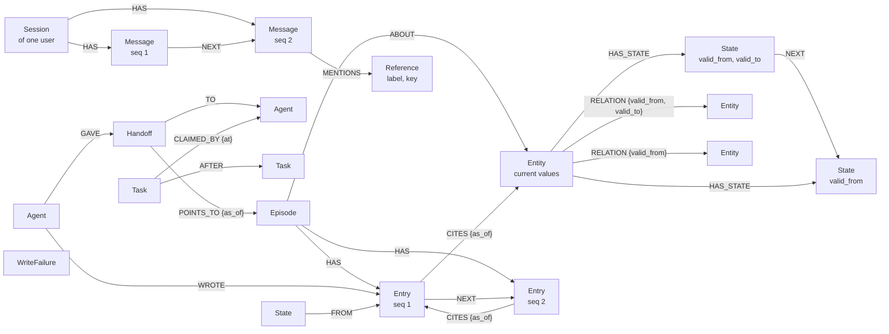

# Lighthouse memory

Agent memory on FalkorDB for structured events. Python package `lighthouse`.

The library stores what is true about entities, keeps every earlier version, and lets agents coordinate through the same graph. It has no LLM on the write path and no code for any one product. The port desk in `../backend` is one application built on it.

**Status: first version.** Built and tested: versioned entities, relations with validity windows, time-travel reads, late rows put into history at their time, episodes with evidence, lessons, playbooks, promotion of what repeats into lessons and playbooks, handoffs, recall by the graph, by words, and by meaning, graph algorithms with answers that are kept until the graph grows, conversation history per user with summaries and erasure, write receipts and failure records, task claims with order and leases, partial updates, algorithms at one time, rows drawn from the text of entries, what relied on a fact or an entry that turned out wrong, the difference between two times and a what-if on top of one, trust in an agent from its record, one graph per tenant, and limits on every input. The full list is in [Capabilities](#capabilities).

## Example

```python
from falkordb import FalkorDB
from lighthouse import Kind, ensure_schema, remember, history, as_of, related
from lighthouse import open_episode, record, close_episode, episodes_about
from lighthouse import hand_off, accept, handoffs_for
from lighthouse import search, pointing_at
from lighthouse import learn, lessons_about, write_playbook, playbooks_for
from lighthouse import groups, connection
from lighthouse import say, messages, said_about

ROOM = Kind("Room", key="code")
TEAM = Kind("Team", key="name")
DEVICE = Kind(
    "Device",
    key="serial",
    times=("last_seen",),
    text=("note",),
    relations={"LOCATED_IN": ROOM, "USED_BY": TEAM},
)

graph = FalkorDB(host="127.0.0.1", port=26379).select_graph("world")
ensure_schema(graph, [DEVICE])  # once, before the first write

remember(
    graph,
    DEVICE,
    by="inventory",
    rows=[
        {
            "key": "d1",
            "t": "2026-01-01T00:00:00Z",
            "values": {
                "status": "ok",
                "note": "pump room sensor",
                "last_seen": "2026-01-01T00:00:00Z",
            },
            "relations": {"LOCATED_IN": "r1", "USED_BY": ["red", "blue"]},
        }
    ],
)
# [{"key": "d1", "status": "created"}]

remember(
    graph,
    DEVICE,
    by="inventory",
    rows=[
        {
            "key": "d1",
            "t": "2026-01-02T00:00:00Z",
            "values": {"status": "hot", "note": "pump room sensor"},
            "relations": {"LOCATED_IN": "r2", "USED_BY": ["blue"]},
        }
    ],
)
# [{"key": "d1", "status": "changed"}]

history(graph, DEVICE, "d1")  # both versions, oldest first
as_of(graph, DEVICE, "d1", "2026-01-01T12:00:00Z")["status"]  # "ok"
related(graph, DEVICE, "d1", "LOCATED_IN")  # ["r2"]
related(graph, DEVICE, "d1", "USED_BY", "2026-01-01T12:00:00Z")  # ["blue", "red"]

# Recall: by the words of the text, and by what points at a thing.
search(graph, DEVICE, "sensor in the pump room", match="any")[0]["key"]  # "d1"
pointing_at(graph, DEVICE, "LOCATED_IN", "r2")  # ["d1"]

# What agents saw, forecast, and did about one event, and how it ended.
open_episode(graph, "d1-overheat", by="watcher", about=[(DEVICE, "d1")])
record(
    graph,
    "d1-overheat",
    "observation",
    by="watcher",
    values={"status": "hot"},
    cites=[(DEVICE, "d1")],
)
# {"id": "d1-overheat/1", "seq": 1, "status": "recorded"}
record(
    graph,
    "d1-overheat",
    "forecast",
    by="forecaster",
    values={"fails_in_hours": 6},
    cites=["d1-overheat/1"],
)
close_episode(
    graph, "d1-overheat", by="reviewer", outcome={"failed": False}, cites=["d1-overheat/2"]
)

episodes_about(graph, DEVICE, "d1")[0]["outcome"]["failed"]  # False

# What was learned from an episode that ended, and what to do next time.
learn(
    graph,
    "hot-in-r2",
    by="reviewer",
    statement="A hot device in room r2 did not fail.",
    supported_by=["d1-overheat"],
    about=[(DEVICE, "d1")],
)
lessons_about(graph, DEVICE, "d1")[0]["weight"]  # 1
write_playbook(
    graph,
    "hot-device",
    by="reviewer",
    trigger={"status": "hot"},
    steps=[{"do": "check the fan"}, {"do": "look again in an hour"}],
    supported_by=["d1-overheat"],
    needs=1,  # 3 by default
)
playbooks_for(graph, {"status": "hot", "room": "r2"})[0]["steps"][0]  # {"do": "check the fan"}

# Work passed to another agent: the handoff points at the record, it does not copy it.
hand_off(
    graph, "h1", by="reviewer", to="planner", points_to=[("Episode", "d1-overheat"), (DEVICE, "d1")]
)
handoffs_for(graph, "planner")[0]["points_to"]  # [("Device", "d1"), ("Episode", "d1-overheat")]
accept(graph, "h1", by="planner")  # {"id": "h1", "status": "accepted"}

# What was said, for each user, in order. A message names what it is about.
say(graph, "ann", "main", "user", "why is d1 hot?", by="ann", mentions=[(DEVICE, "d1")])
say(graph, "ann", "main", "helper", "the fan stopped", by="desk", mentions=[(DEVICE, "d1")])
# {"id": "main", "seq": 2, "status": "said"}
[m["text"] for m in messages(graph, "ann", "main")]  # ["why is d1 hot?", "the fan stopped"]
said_about(graph, "ann", (DEVICE, "d1"))[0]["text"]  # "the fan stopped": the newest first

# The graph as a whole: what belongs together, and how two things are connected.
groups(graph, [DEVICE])[0]["size"]  # 5: d1 with every room and team it ever had
connection(graph, (DEVICE, "d1"), (ROOM, "r1"))
# [{"from": ("Device", "d1"), "relation": "LOCATED_IN", "to": ("Room", "r1"), "forward": True,
#   "current": False, "since": 2026-01-01 00:00, "until": 2026-01-02 00:00}]
```

## Model



- An **entity** is a node with the label and key of its `Kind`, and the label `Entity` that all entities share. It holds the current values, so a query or an index on the entity sees what is true now.
- A **State** is one version of the entity's values. It has `valid_from`, and `valid_to` once a later version replaced it. States of one entity form a chain through `NEXT`. `seen_last` is the last time a row repeated the State, when one did after it began.
- A **relation** is an edge from one entity to another with its own `valid_from` and `valid_to`. A relation that did not change keeps its edge when another value changes.
- `by` on every State and relation edge names the agent or source that wrote it. `recorded_at` is the time the library stored it. `valid_from` is the time the fact became true.
- An **episode** is the record of one event. Its **entries** are numbered in the order they were written: an observation, a forecast, an action, or any type the application names. The entry of type `outcome` closes the episode.
- An entry **cites** its evidence: earlier entries, and entities. A cited entity is pinned to the time of the entry, so `as_of()` gives the State the agent saw. An **Agent** node has a `WROTE` edge to each entry it wrote.
- A **lesson** is what was learned from episodes that ended. It points at the episodes for it and against it, and at the episodes where it was used. A **playbook** is what to do when a situation comes again: a trigger, ordered steps, and the episodes it was drawn from. A new version replaces the one before; no version is changed.
- A **handoff** passes work from one agent to another. It points at entries, episodes, and entities, and holds no copy of them. Only its receiver can accept it, once.
- A **session** holds what was said with one user, as **messages** in the order they were written, and one summary of the messages up to a number. A session can be forgotten: it is the one thing the library deletes. A message **mentions** things by name: a **Reference** holds the label and the key of an entity or a record, and no edge to it, because the thing may be in another graph.
- A **WriteFailure** is a write that did not happen: the reason, the kind, the key, and up to 2,000 characters of the refused content. The same refusal again is counted on the same node, with `times` and `last_at`, so a bad row that a feed sends on every read does not grow the graph.
- An entity of kind `Thing` whose text has no vector of the current model has the label `ThingToEmbed` too, from the write that changed its text: `embed()` reads only those.
- A **Stamp** is one node with a random id that `ensure_schema()` gives a graph once. A graph that is deleted and made again under its name has another stamp: it is another graph. It also counts the entries stored in the graph, and keeps the marks of the jobs that read entries off the write path: how far each has come.
- Times are FalkorDB `localdatetime` values in UTC, in whole seconds.

## The write rule

A row is the full picture of one entity at time `t`. What the row does not name is no longer true: a missing value is removed, a missing relation is closed.

`remember()` returns one receipt per row, in order.

| Status | Meaning | Stored |
| --- | --- | --- |
| `created` | First State of the entity | Entity, State, relation edges |
| `changed` | The row differs from the current State and is later | New State; old State closed; changed relation edges closed or opened |
| `inserted` | The row came late: its time is inside an earlier State, or before the first | New State between the two it falls between, or the next State starts earlier; relation edges cut or added for that stretch of time |
| `unchanged` | The content is already recorded for time `t` | `seen_last` of the State, when `t` is later |
| `stale` | The row came late, after a row with a later time that repeated the State it falls in | WriteFailure |
| `conflict` | Another row with other content has the same time | WriteFailure |
| `missing` | The entry the row names does not exist | WriteFailure; nothing else, not even the entity |
| `invalid` | The row cannot be stored | WriteFailure |
| `failed` | The database refused the query | WriteFailure |

Consequences of the rule:

- The same rows give the same history, however often they are sent. A replay of old rows is `unchanged`, not an error.
- Rows that arrive in another order give the history of their times. A late row ends the State it falls in at its time, and holds until the next State starts. The entity node keeps the current values: a late row is never the current State.
- The library keeps the changes, not every row. For each State it keeps `seen_last`, the last time a row repeated it. A late row with a time before `seen_last` is `stale`: the State held again after the row, at a time the library no longer knows exactly, so it is refused and stored as a failure, never placed wrong. A source that sends only changes never repeats a State, and its late rows are always `inserted`.
- When a late row says what the next State says, that State starts earlier. Its old start becomes its `seen_last` when it has none: a row said it then.
- A late row replaces the `NEXT` link between the two States it falls between. This is the one write that deletes, and the same query gives the graph a new stamp.
- A row can name the entry it comes from: `{"key", "t", "values", "relations", "entry": "look/3"}`, the id that `record()` returned for an observation. A State that the row adds points at that entry with a `FROM` edge, and `history()` and `as_of()` give its id as `"entry"`. The entry is evidence, not content: the same values from another entry are `unchanged`, and the State keeps the entry it came from. Entries are never deleted, so the entry is checked before the write, in one read for the batch.
- No model decides what a new fact replaces. A value replaces the same value of the same entity. A relation target that is not in the new row is closed.

**Partial updates.** `update(graph, kind, key, t, by, values=None, relations=None, entry=None)` changes what it names from time `t` on, and keeps the rest as the current State says:

```python
update(graph, DEVICE, "d1", "2026-01-01T13:00:00Z", by="agent", values={"status": "hot"})
update(graph, DEVICE, "d1", "2026-01-01T14:00:00Z", by="agent", relations={"LOCATED_IN": "r2"})
```

- A value of `None` is removed. A relation it names gets the targets it gives and keeps no other; a relation it does not name keeps its edges.
- It reads the current State, makes the full row, and writes it by the write rule, so its receipt is one of `remember()`. The row carries the State it was made from: if another writer added a State in between, nothing is written and `update()` reads again. A change is never written over one it did not see. After 5 reads that each found another writer, it is `busy`: refused and stored.
- It changes what is current. A time before the current State is `stale`, refused and stored: for an earlier time, send the full row to `remember()`. Two updates of one entity in the same second are a `conflict`, as two rows of one time are.

**Tasks.** A task is free when it is open, or when its claim ran out, and when every task it comes after is done. `claim()` gives the oldest free task of a kind in one query.

- A task can only come after tasks that exist, so the order of tasks has no cycle. A task waits while one it comes after is open or claimed, and is free once all of them are done.
- A claim with a `lease` holds that many seconds, at most seven days. After that, another agent can claim the task, and the first one can no longer complete it. While nobody has, the first one still can. There is no renewal: an agent that needs longer takes a longer lease.
- `release()` gives a task back. Every claim stays as a `CLAIMED_BY` edge; the task's `owner` names the last one.

## Episodes

`open_episode()`, `record()`, and `close_episode()` each return one receipt.

| Status | Meaning | Stored |
| --- | --- | --- |
| `opened` | The episode was made | Episode, `ABOUT` edges |
| `exists` | An episode with this id is there already | Nothing |
| `recorded` | The entry took the next number of the episode | Entry, `NEXT`, `CITES`, `WROTE` edges |
| `unknown` | The episode does not exist | WriteFailure |
| `closed` | The episode has its outcome | WriteFailure |
| `missing` | Something in `about` or `cites` does not exist | WriteFailure |
| `invalid` | The values, the references, or the time cannot be stored | WriteFailure |
| `failed` | The database refused the query | WriteFailure |

- An entry is appended with one query. Entries written at the same moment get one order, and no number is used twice.
- Evidence must exist. An entry cannot cite an entry or an entity that is not in the graph.
- A refused entry uses no number. Its content is kept in the WriteFailure.
- An episode cannot be opened again after it is closed, and what an entry says cannot be changed. An entry that turns out wrong is marked with `invalidate_entry()`, not changed or deleted: see [What relied on it](#what-relied-on-it).

## Recall

Four ways to find what is in memory. The library holds no model: search by meaning uses a function that the application passes in.

| Function | Finds | By |
| --- | --- | --- |
| `pointing_at(graph, kind, relation, key, when=None)` | The entities whose relation pointed at one target, now or at `when` | One hop against the relation edge |
| `similar(graph, kind, key, relations=None, limit=10)` | Entities of the same kind that share relation targets with one entity, most shared first | Two hops through the shared targets |
| `search(graph, kind, question, limit=10, match="all")` | Entities whose text has the words of a question, best first | FalkorDB's full-text index on the words of the properties in `Kind(text=...)` |
| `search_history(graph, kind, question, limit=10, match="all")` | States of entities of the kind whose text had the words, now or earlier, best first, each with its validity window and its entry | The full-text index of States |
| `search_entries(graph, question, limit=10, match="all")` | Entries of episodes whose text values have the words, best first | The full-text index of entries |
| `nearest(graph, kind, question, embedder, model, limit=10)` | Entities whose text is closest in meaning to a question, with the cosine similarity | FalkorDB's vector index on the vectors that `embed()` made |
| `nearest_entries(graph, question, embedder, model, limit=10)` | Entries whose text is closest in meaning to a question | The vector index of entries, on the vectors that `embed_entries()` made |

`fuse({"graph": ..., "words": ..., "meaning": ...})` merges the results into one ranking by reciprocal rank fusion. It uses the places only, because the scores of the three ways cannot be compared. Each result says which ranking put it where.

- `similar()` says why: each result has `through`, the `(relation, target)` pairs it shares. It compares the current relations of the entity with every relation the others ever had, so entities of the past are found.
- `search()` sees the current text of an entity. A value that changed is found by its new words only. `search_history()` finds the old words in the States, and says when each State held.
- The index never reads a text as it is. A node that can be searched keeps `words`: the letters and digits of its text, one space between them, and the index reads that. FalkorDB's index does not split words at a line break, a no-break space, or an underscore, so `"first line\nsecond"` indexed as it is would never be found by "line". `history()`, `search()`, `episode()`, and `messages()` do not show `words`.
- States of every kind share one index. `search_history()` keeps the States of an entity of the kind it was asked about.
- A question is never sent to the index as it is. The index has a query language (`*`, `-`, `|`, `@field:`, `"..."`); only the letters and digits of the question are sent, as at most 20 words. So `*` does not list every entity and `@note:x` does not choose a field.
- `similar()`, `search()`, and `nearest()` stop after 5 seconds. FalkorDB can stop a read.

Search by meaning:

```python
MANUAL = Kind("Manual", key="code", text=("title", "body"), dimensions=384)


def embedder(texts):  # the application's model: a list of texts in, one vector for each out
    ...


embed(graph, MANUAL, embedder, model="name-of-the-model")  # off the write path, until waiting is 0
nearest(graph, MANUAL, "the seal of my pump leaks", embedder, model="name-of-the-model")
```

- `embed()` gives a vector to each entity whose text has none, at most `limit` in one call, and returns `{"embedded", "waiting"}`. It is the only place where the model is asked about stored text. `remember()` never asks it.
- `embed()` reads only the entities that wait: the write that gives an entity text, or changes it, gives it the label `ThingToEmbed` in the same query, and the write of its vector takes the label off. A label, because a write replaces every property of the entity and keeps its labels. A call costs what waits, not what the kind holds. After a change of model, the first call marks every entity with text once, a page at a time.
- A vector stands for the text it was made from. The write that changes the text of an entity takes its vector out of the index in the same query, so `nearest()` never answers from text that is gone. The entity is found again after the next `embed()`. A change of a value that is not text keeps the vector.
- A vector is stored only if the text is still what the model was asked about. A text that changed while the model worked gets no vector from that call.
- The name of the model is stored with each vector. Vectors of another model are never compared; `embed()` with a new name replaces them.
- What the embedder returns is input like any other: one vector for each text, of the declared size, of finite numbers, not all zeros. Anything else raises an error and nothing is stored.
- Entries get vectors in a graph whose schema gives them an index: `ensure_schema(graph, kinds, entry_dimensions=384)`. `embed_entries(graph, embedder, model)` gives a vector to each entry with text that has none of this model; the text of an entry is its text values, in the order of their names, one per line. An entry never changes, so its vector stands for it for good. `embed_entries()` reads the entries stored since its mark for that model, by their serial; see [Free text](#free-text).

## Algorithms

Four questions about the graph as a whole. FalkorDB computes the answers; the library names what it finds and bounds the cost.

| Function | Answers | By |
| --- | --- | --- |
| `groups(graph, kinds, relations=None, records=(), at_least=2, limit=100, show=100, at=None)` | Which things are linked, directly or through other things: the sets, largest first | `algo.WCC` |
| `important(graph, kinds, relation=None, limit=10, at=None)` | Which entities much points at, most of all when that is important itself | `algo.pageRank` over the entities of every kind |
| `between(graph, kinds, relations=None, limit=10, sample=None, seed=1, at=None)` | Which entities lie on the shortest paths between other entities | `algo.betweenness` |
| `connection(graph, start, end, kinds=(), relations=None, max_hops=6, at=None)` | How two things are connected: the shortest chain of relations, step by step | `shortestPath` |

```python
groups(graph, [DEVICE], ["ABOUT"], records=["Episode"])  # the episodes about the same devices
important(graph, [DEVICE], "LOCATED_IN", limit=3)  # the rooms that most devices were in
between(graph, [PERSON])  # who stands between persons that do not know each other
connection(graph, (DEVICE, "d1"), (DEVICE, "d7"))  # through which rooms and teams
```

- **Without `at`, they see every relation that was ever true.** A relation edge is never deleted, and these searches cannot tell an open edge from a closed one. `connection()` says for each step whether the relation holds now, since when, and until when. Where several relations join the two things of a step, it tells of one that holds now, and otherwise of the one that ended last.
- `groups()` joins whichever way the relations point. With `records`, the records of the library take part: with `records=["Episode"]` and `relations=["ABOUT"]`, a set is the episodes about the same entities, and those entities.
- `important()` ranks over the entities of every kind and the edges of one relation, or of every relation. The scores of all entities add up to 1. FalkorDB stops at a fixed precision: in the tests, a score is within 0.0005 of the exact value.
- `between()` follows the direction of the relations. An entity scores only when relations lead into it and out of it: a relation from a kind to itself, or a chain of kinds. Where one kind only points at another, every score is 0.
- `between()` counts paths from a sample of the entities and scales the counts up. Without `sample`, it follows 10,000,000 relations at most, from 32 entities at least: a graph that small gets the exact count, a larger one an estimate. On a test graph with hubs (6,000 entities, 30,000 relations), a sample of 32 found 7 of the true top 10, 128 found 8, and 256 found 9. Where the scores of all entities are close, no sample can order them.
- `connection()` follows relations in either direction. It follows the relations of the kinds of its two ends; `kinds` adds a kind that points at both, and `relations=[..., "ABOUT"]` lets it go through records.
- The first result of each is the oldest of equals: for the same graph, the same question gets the same answer.

**At one time.** With `at`, each of the four sees the relations that held at that time and the entities that existed then, and nothing else:

```python
noon = "2026-01-01T12:00:00Z"
groups(graph, [DEVICE], ["LOCATED_IN"], at=noon)  # which devices shared a room then
connection(graph, (DEVICE, "d1"), (DEVICE, "d7"), at=noon)  # how they were joined then
```

- FalkorDB's algorithms cannot keep to the edges of one time, so the relations that held then are read in one query, and the algorithms run in the library: union-find, PageRank by the same rules as FalkorDB's, Brandes' count of paths, and a search for the shortest chain. For a time when every relation held, they give the answers of FalkorDB; the tests check that, and check each against a plain implementation on the relations the test wrote for that time.
- An entity exists from its first State. An entity that only relations point at exists while one of them holds.
- Records have no time: with `at`, no record takes part, and the edges of records are not followed.
- `connection()` searches from both ends, a step at a time from the end with fewer to look at, and reads only the neighbours of those. A step tells of a relation that held then; `current` and `until` say whether it holds now.
- `between()` here counts paths in Python: from 32 entities at least, and from as many as 2,000,000 steps allow. The seed picks them in another way than FalkorDB, so a sampled count differs from the one without `at`.
- One answer reads at most 1,000,000 relations or entities; more is refused. Answers at a time are not kept: a row that came late can change what held at a time without a node or an edge more.

| On 20,000 entities and 100,000 relations that held at the time | Answer |
| --- | --- |
| `groups(..., at=...)` | 240 to 270 ms |
| `important(..., at=...)` | 450 to 530 ms |
| `between(..., at=...)`, from 32 entities | 0.8 to 1.2 s |
| `connection(..., at=...)`, four and five steps | 2 to 6 ms |

One laptop, three runs each, with a script that is not in the repository. Reading the relations is 130 to 250 ms of each of the first three. Before the search for a chain read only the neighbours, `connection()` at a time took 600 ms; before the nodes were found by their id first, 970 ms.

**An answer is kept until the graph grows.** `groups()`, `important()`, and `between()` keep their answers in the process. The same question is answered from there while the graph has as many nodes and edges, of the labels and types that the question reads, as it had. A graph only grows, so equal numbers mean the same nodes and edges, and FalkorDB has those numbers at hand without a scan. The queries that delete, `forget_session()` and a late row that replaces the `NEXT` link between two States, give the graph a new stamp, and no answer from before is given again. A write that only changes values, or that adds episodes the question does not read, keeps the answer. `important()` without a relation reads every edge, so any new edge makes its answer new.

| On 100,000 entities and 550,000 relations | First answer | The same question again |
| --- | --- | --- |
| `groups()` | 77 ms | 0.2 to 0.3 ms |
| `important()` | 64 ms | 0.2 to 0.3 ms |
| `between()`, from 32 entities | 233 ms | 0.2 to 0.3 ms |
| `connection()`, four steps | 0.5 ms | 0.4 ms: not kept, it reads what holds now |

One laptop, three runs, with a script that is not in the repository. Before the best rows were picked ahead of naming them, and before the counts were queries of their own, the first answers took 90, 175, and 670 ms; `between()` then counted from 100 entities.

- Answers are kept only for a graph that has its stamp from `ensure_schema()`. The stamp tells a graph from another one made later under its name.
- Up to 64 answers are kept for one database client, each with up to 10,000 names. A caller gets lists of its own: to change them changes nothing that is kept.
- Delete nothing from a graph by hand. A kept answer does not see it.
- FalkorDB cannot stop these three searches while they run, and a write to the graph waits for them: a write sent during a search of 2 seconds waited 1.7 seconds. That is why each has a bounded cost, and why an answer is computed once.

## Lessons and playbooks

The three kinds of memory are graph structures. An episode is what happened. A lesson is what was learned from episodes. A playbook is what to do. The library writes no lesson and no playbook of its own: an agent or a rule of the application says what was learned or what the steps are. The library keeps the evidence, counts it, and ranks by it.

**Lessons.** `learn()` stores a statement with the episodes it was learned from. Every one of them must have ended, and there must be at least one: a claim with no evidence is refused.

| Function | Does |
| --- | --- |
| `learn(graph, id, by, statement, supported_by, about, values, at)` | Stores a lesson that rests on the given episodes and is about the given entities. |
| `weigh(graph, id, by, episode_id, agrees)` | Adds one more episode for the lesson or against it. An episode counts once. |
| `used(graph, id, by, episode_id, helped=None)` | Records that the lesson was used in an episode, and whether that helped. The result is said once. |
| `retire(graph, id, by, why)` | Says the lesson no longer holds. It stays in the graph and is no longer given out. |
| `lesson(graph, id)` | The lesson with its weight and its evidence. |
| `lessons_about(graph, kind, key, at_least=1, since=None)` | The lessons about an entity that still hold, heaviest first. |

- The **weight** of a lesson is `support - against + helped - failed`: the episodes that agree, minus those that do not, plus the uses that led to a correct result, minus those that did not. A lesson that is contradicted or that fails sinks below `at_least` and is no longer given out.
- A lesson **fades** when nothing touches it: `since` leaves out lessons that no episode has supported, contradicted, or used since that time.
- Every count is changed in the same query that makes its edge. Eight agents that weigh one lesson at once lose no count, and an episode that eight agents add is counted once.

**Playbooks.** Writing what an agent will do is riskier than writing what it knows. So a playbook has four guards.

| Guard | How |
| --- | --- |
| Enough evidence | `write_playbook()` needs 3 episodes that ended (`needs` changes the number, never below 1). Every episode named must be real. |
| Never changed | A write makes the next version and switches the one before off. Old versions stay, with their steps and their record. |
| An off switch | `switch(graph, name, by, on=False)`. Only the newest version can be switched on. |
| A stop of its own | After 3 failures in a row (`stop_after`) the playbook switches itself off, in the query that records the failure. A success breaks the row. |

| Function | Does |
| --- | --- |
| `write_playbook(graph, name, by, trigger, steps, supported_by, needs=3, at)` | Writes the next version. |
| `playbooks_for(graph, situation)` | The playbooks that are switched on and whose trigger fits: every property of the trigger is in the situation with the same value. Best record first. |
| `ran(graph, name, by, episode_id, succeeded=None, stop_after=3)` | Records a run in an episode and how it ended. The result is said once. |
| `switch(graph, name, by, on)` | Switches the newest version on or off. Switching on clears the row of failures. |
| `playbook(graph, name, version=None)` | One version with its trigger, steps, counts, and evidence. |

An entry can cite the lesson it used, and a handoff can point at a playbook: `("Lesson", id)` and `("Playbook", "name#version")` are references.

**Promotion.** What repeats in episodes that ended becomes a lesson or a playbook. The library cannot tell what a repeat is, so the application passes a rule: a function of one episode that says what the episode shows.

```python
def rule(episode):  # what one episode that ended shows
    outcome = episode["entries"][-1]
    return [
        {
            "lesson": "d1-fan",
            "statement": "d1 gets hot because of its fan",
            "about": [(DEVICE, "d1")],
            "agrees": outcome["cause"] == "fan",
        },
        {
            "playbook": "cool-d1",
            "trigger": {"status": "hot", "device": "d1"},
            "steps": [{"do": outcome["step"]}],  # what fixed it
        },
        {"ran": "cool-d1", "succeeded": outcome["fixed"]},  # a playbook that ran in it
    ]


promote(graph, "reviewer", rule, at_least=3)
# {"episodes": 12, "lessons": [{"id": "d1-fan", "status": "learned", "new": 0}],
#  "playbooks": [{"id": "cool-d1#1", "version": 1, "status": "written"}], "runs": [...]}
```

- A lesson is learned when `at_least` episodes agree with it, from those episodes. After that, each episode for it or against it weighs it.
- A playbook is written when `at_least` episodes show the same trigger and steps. When more episodes show other steps than the newest version has, the next version is written. A playbook that was switched off is not written again with the same steps.
- A run is judged once, with `ran()`. Three failures in a row switch the playbook off.
- Every one of these counts an episode once, so `promote()` can run after every poll and writes nothing twice. A rule that gives something that is not a claim stops the promotion before it writes.
- The receipt of each lesson and playbook says what happened: `learned`, `weighed`, `written`, `waiting` (with how many episodes agree so far), `unchanged`, or the refusal of the library with the id it was for.

## Handoffs

`hand_off()` and `accept()` each return one receipt.

| Status | Meaning | Stored |
| --- | --- | --- |
| `given` | The handoff was made | Handoff, `GAVE`, `TO`, `POINTS_TO` edges |
| `exists` | A handoff with this id is there already, or its receiver accepted it before | Nothing |
| `accepted` | The receiver took it | `accepted_at` on the handoff |
| `refused` | An agent that is not the receiver tried to accept it | WriteFailure that names who tried |
| `unknown` | There is no such handoff | WriteFailure |
| `missing` | Something in `points_to` does not exist | WriteFailure |
| `invalid` | It points at nothing, or the values, references, or time cannot be stored | WriteFailure |
| `failed` | The database refused the query | WriteFailure |

- A handoff must point at something that exists. A handoff that only carries text is refused.
- A handoff given again with the same id changes nothing. Its receiver and what it points at cannot be replaced.
- `accept()` reads the receiver and marks the handoff in one query, so it is accepted once.

## Conversations

What was said, for each user, in order. The functions take the graph that holds the conversations: with one graph for each tenant, that is the graph of the tenant.

| Function | Does |
| --- | --- |
| `say(graph, user, session_id, role, text, by, mentions=(), values=None, at=None)` | Adds one message to a session of the user. The first message opens the session. Returns a receipt with the number of the message. |
| `messages(graph, user, session_id, last=20, before=None)` | The last messages of a session, oldest first. `before` reads further back. |
| `sessions(graph, user, limit=20)` | The sessions of the user, the one written to last first, each with how many messages it holds. |
| `said_about(graph, user, reference, limit=20)` | The messages of the user that mention one thing, newest first. |
| `said(graph, user, question, limit=10, match="all")` | The messages of the user whose text has the words of a question, best first. |
| `summarize(graph, user, session_id, text, upto, by)` | Stores what the messages up to number `upto` come to. A session has one summary; a later one takes its place. |
| `context(graph, user, session_id, last=20)` | What a model needs to go on: the summary, the messages after it, and how many messages wait for a summary. |
| `forget_session(graph, user, session_id)` | Deletes one session and everything of it. |
| `forget_user(graph, user)` | Deletes everything the user said in the graph. |

| Status of `say()` | Meaning | Stored |
| --- | --- | --- |
| `said` | The message took the next number of the session | Message, `HAS`, `NEXT`, `MENTIONS` edges; the Session with the first message |
| `invalid` | The text, the mentions, the values, or the time cannot be stored | WriteFailure |
| `failed` | The database refused the query | WriteFailure |

- **A session belongs to one user, and every call names the user.** The key of a session holds the user and the id. So two users can both have a session `main`, and no id that one user asks for can reach a session of another. A session that the user does not have reads as empty.
- A message is added with one query: it takes its number and its place after the last message together. Messages written at the same moment get one order, and no number is used twice. A refused message uses no number.
- `messages()` finds each message by its key, so the last 20 of a session cost the same whether it holds 20 messages or 20,000: 0.1 ms in the database.
- **A mention is a name, not an edge.** `mentions=[(VESSEL, 9000001)]` stores the label and the key. The thing is not looked up: with one graph for each tenant and one that all share, it is in the other graph, and a query cannot span two graphs. Read the thing from its own graph by that key.
- `said()` sends only the letters and digits of a question to the index, as `search()` does. It sees the text of messages, not their values.
- The words of a message hold one more word for its user, from a hash of the name that is the same in every process, and `said()` asks the index for it. So the index gives the messages of the user who asks, not those of every user. The check of the user stays, since a message's text could hold another user's word.
- `role` is a name the application chooses, such as `user` and the name of an agent. `by` is who wrote the message. Both come from the caller.
- The time of a message, `at`, is when it was said. The order of the sessions of a user follows the time the library stored the last message, which a caller cannot set.

A long session is read as a summary and the messages after it:

```python
found = context(graph, "ann", "main", last=20)
# {"summary": None, "upto": 0, "messages": [the last 20], "waiting": 37}
text = model_sums_up(messages(graph, "ann", "main", last=37, before=found["messages"][0]["seq"]))
summarize(graph, "ann", "main", text, upto=37, by="desk")
# {"id": "main", "upto": 37, "status": "summed"}
context(graph, "ann", "main")  # the summary, the 20 messages after message 37, and "waiting": 0
```

| Status of `summarize()` | Meaning | Stored |
| --- | --- | --- |
| `summed` | The summary stands for the messages up to `upto` | The text, `upto`, who wrote it, and when, on the Session |
| `unknown` | The user has no such session | WriteFailure |
| `stale` | The summary that is there reaches further | WriteFailure |
| `invalid` | The text cannot be stored, or `upto` is not the number of a message | WriteFailure |
| `failed` | The database refused the query | WriteFailure |

- The summary is the application's text: the library holds no model. `context()` says with `waiting` how many messages are neither summed nor given, so the application knows when to sum up again.
- A summary is not a message. `messages()` and `said()` do not give it.

**Forgetting is the one place where the library deletes what was written.** (A late row replaces the `NEXT` link between two States; see the write rule.) `forget_session()` deletes the messages of a session, the session with its summary, each reference that no other message mentions, and what was kept of its refused messages and summaries. `forget_user()` does that for every session of the user. After it, no property of any node or edge of the graph holds what the session held: a test reads them all.

- A session is deleted in steps of 200 messages, the last ones first, and the session counts down with them. So after every step it is a shorter session that reads right, and it goes with its last message. A message that is said while this runs goes too; one that is said after opens the session again at number 1.
- What a refused message held is kept in a WriteFailure, as for every refused write. Those of a conversation name their owner, so they are found and deleted with the rest.
- Other parts of the library rely on a graph that only grows: an answer of an algorithm is kept while the numbers of nodes and edges stay. Each query that deletes gives the graph a new stamp in the same step, so no answer from before is given again.
- What it does not reach: the name of a user where the application gave it as `by` of another write, and copies of the database outside it.

## Free text

What agents write in entries can become rows. The library holds no model: the application passes the extractor, a function that reads one entry and gives the rows it finds.

```python
def extractor(entry):  # the application's model, or plain code: one entry in, rows out
    return [{"key": "d1", "values": {"status": "hot"}, "relations": {"LOCATED_IN": "r2"}}]


extract(graph, DEVICE, extractor, by="reader", types=["observation"])  # off the write path
# {"read": 12, "rows": {"created": 3, "changed": 5, "unchanged": 4}, "waiting": 0}
```

- `extract()` reads entries with text that it has not read for the kind yet, oldest first, at most `limit` in one call. Each entry gets a `READ_BY {kind, at, rows}` edge to the agent that read it, so it is read once for each kind.
- Every entry takes a **serial**, the next number of the graph, in the query that stores it. FalkorDB runs one write of a graph at a time, so serials follow the order in which entries were stored, and a job that has seen serial n has seen every entry before it. A call of `extract()` reads the serials past its mark, through their index, a slice at a time, and moves the mark past what it did. The mark is kept on the graph's stamp, one for each kind and set of types. So a call costs what came since, also on a first run over a graph full of entries, and no entry is passed over.
- The rows are written by the write rule. Each State they add points at the entry with `FROM`, whatever entry the extractor named. A row without `t` is true from the time of the entry.
- What the extractor gives is input like any other: a row that cannot be stored is refused and kept as a failure, and the entry counts as read. An extractor that raises stops the call, and its entry waits for the next one. An answer that is not a list of at most 1,000 rows raises an error.
- Messages of conversations are not read: they can be erased, and facts drawn from them would stay. An application that wants them read writes what it takes from them as entries, where it can decide what may stay.
- With `embed_entries()` and `nearest_entries()`, the text of entries is found by meaning too.

## What relied on it

A fact can turn out wrong: a sensor reported nonsense, or a row came late and rewrote what held. The graph knows what rested on it, because every entry cites its evidence, every State points at the entry it came from, and every lesson and playbook names its episodes.

| Function | Gives |
| --- | --- |
| `impact_of_state(graph, kind, key, since, until)` | What relied on an entity during `[since, until)`: the entries that cited it then, the entries that cited those, up to six steps, the States drawn from them, their episodes, the handoffs still waiting that point at any of it, and the lessons and playbooks that rest on those episodes, with how much of their evidence is affected |
| `impact_of_entry(graph, entry_id)` | The same for one entry |
| `invalidate_entry(graph, entry_id, by, reason, at=None)` | Marks an entry as wrong, with who said so and why, and gives its impact. Nothing is deleted or changed; the mark is `invalidated_at`, `invalidated_by`, and `invalidated_why` on the entry, and an `INVALIDATED` edge from the agent |

- `invalidate_entry()` returns `{"id", "status"}` with `invalidated` (and `impact`), `exists` when it was marked before, or a refusal kept as a WriteFailure: `unknown`, `invalid`, or `failed`.
- A lesson is at risk when the episodes left for it would no longer carry it; a playbook, when fewer than three would.
- Only these functions and `agent_trust()` read the mark. Recall, lessons, and playbooks still use a marked entry: what to do about it is the application's to decide.

## Two times, and what if

| Function | Gives |
| --- | --- |
| `diff_between(graph, kinds, t1, t2)` | What changed between two times: the entities that began, the values that changed, the relations that opened and closed, and the episodes that opened and closed |
| `what_if(graph, kinds, hypothetical_rows, at=None, situation=None)` | The graph at `at` with rows that were not written laid over it, in memory: the sets that relations join and the PageRank of each entity, before and after, the entities whose rank moved most, and the playbooks that would fit `situation`. It writes nothing |

`what_if()` uses the union-find and the PageRank of the algorithms at one time, which the tests compare with plain implementations and with FalkorDB's.

## Trust in an agent

`agent_trust(graph, agent)` counts what the graph records of an agent's work, for it and against it: the entries it wrote against those marked wrong, the closed episodes it wrote in that a lesson rests on against those that contradict one, the playbook runs it recorded that succeeded against those that failed, and the versions it wrote that held at least a minute against those replaced sooner. The score is the mean of the four rates, each smoothed as `(for + 1) / (for + against + 2)`, over the kinds of evidence the agent has, so the many versions of a busy writer do not drown the rest. With no evidence, the score is `None`.

## References

Episodes and handoffs point at things with references. `episode()` and `handoffs_for()` give references back in the same form, so what is read can be cited.

| Reference | Points at | Allowed in |
| --- | --- | --- |
| `(Kind, key)` | An entity, pinned to the time of the entry or handoff. In `mentions`, a name only | `about`, `cites`, `points_to`, `mentions` |
| `"ep/3"` or `("Entry", "ep/3")` | One entry | `cites`, `points_to` |
| `("Episode", "ep")` | A whole episode | `cites`, `points_to` |
| `("Lesson", id)`, `("Playbook", "name#2")` | A lesson, or one version of a playbook | `cites`, `points_to` |

## API

| Function | Does |
| --- | --- |
| `Kind(label, key, times, relations, text, dimensions)` | Declares a kind of entity. Names are checked, because they go into query text. A `Kind` cannot change after it is made. `SELF` as a relation target means the kind itself. `text` names the values that can be searched; `dimensions` is the size of the vectors for that text. |
| `ensure_schema(graph, kinds, entry_dimensions=0)` | Unique constraint on the key of each kind and of each kind it points at, full-text indexes on the words of each kind with text, of its States, of entries, and of messages, a vector index for each kind with dimensions, and one for entries when `entry_dimensions` is given. Gives the graph its stamp, once. Returns only when every index and constraint is operational. Stops if a vector index has another size than the kind declares. |
| `remember(graph, kind, rows, by)` | Stores rows by the write rule. Returns receipts. |
| `update(graph, kind, key, t, by, values=None, relations=None, entry=None)` | Changes the values and relations it names from `t` on; the rest stays. Returns a receipt. |
| `history(graph, kind, key)` | Every State of an entity, oldest first, each with `"entry"` when a row named one. |
| `as_of(graph, kind, key, when)` | The State valid at `when`, or `None`, with `"entry"` when a row named one. |
| `related(graph, kind, key, relation, when=None)` | Keys the entity pointed at through a relation, now or at `when`. |
| `pointing_at(graph, kind, relation, key, when=None)` | Keys of the entities that pointed at a target. The reverse of `related()`. |
| `similar(graph, kind, key, relations=None, limit=10)` | Entities that share relation targets with one entity, with what they share. |
| `search(graph, kind, question, limit=10, match="all")` | Entities whose text has the words of a question, with a score. |
| `search_history(graph, kind, question, limit=10, match="all")` | States whose text had the words of a question, now or earlier. |
| `search_entries(graph, question, limit=10, match="all")` | Entries whose text values have the words of a question. |
| `embed(graph, kind, embedder, model, limit=100)` | Gives vectors to entities whose text has none. Returns how many got one and how many wait. |
| `nearest(graph, kind, question, embedder, model, limit=10)` | Entities whose text is closest in meaning to a question. |
| `embed_entries(graph, embedder, model, limit=100)` | Gives vectors to entries whose text has none of this model. |
| `nearest_entries(graph, question, embedder, model, limit=10)` | Entries whose text is closest in meaning to a question. |
| `fuse(rankings, limit=10)` | One ranking from several, with the place each one gave. |
| `groups(graph, kinds, relations=None, records=(), at_least=2, limit=100, show=100, at=None)` | The sets of things that relations join, largest first, each with its size and its oldest members. |
| `important(graph, kinds, relation=None, limit=10, at=None)` | Entities by PageRank, with the score. |
| `between(graph, kinds, relations=None, limit=10, sample=None, seed=1, at=None)` | Entities by the shortest paths that run through them, with the count. |
| `connection(graph, start, end, kinds=(), relations=None, max_hops=6, at=None)` | The shortest chain of relations between two references, or `None`. Each step says what holds now. |
| `open_episode(graph, id, by, about, at)` | Starts the record of one event about the given entities, each as `(Kind, key)`. |
| `record(graph, id, type, by, values, cites, at)` | Appends one entry. `cites` holds references to its evidence. |
| `close_episode(graph, id, by, outcome, cites, at)` | Records the outcome as the last entry and closes the episode. |
| `episode(graph, id)` | The episode with its entries in order, each with what it cites. |
| `extract(graph, kind, extractor, by, types=None, limit=100)` | Writes the rows that the extractor finds in entries not yet read for the kind. Returns how many were read, the statuses of the rows, and how many wait. |
| `episodes_about(graph, kind, key)` | The episodes about one entity, newest first, each with its outcome. |
| `learn`, `weigh`, `used`, `retire`, `lesson`, `lessons_about` | Lessons. See [Lessons and playbooks](#lessons-and-playbooks). |
| `promote(graph, by, rule, at_least=3)` | Reads every episode that ended and writes the lessons and playbooks that a rule of the application finds in them. |
| `write_playbook`, `playbooks_for`, `ran`, `switch`, `playbook` | Playbooks. |
| `hand_off(graph, id, by, to, points_to, values, at)` | Passes work to another agent by pointing at what it must read. |
| `accept(graph, id, by)` | The receiver takes a handoff. |
| `handoffs_for(graph, agent, waiting_only=True)` | What was handed to an agent, oldest first, each with what it points at. |
| `say`, `messages`, `sessions`, `said_about`, `said`, `summarize`, `context`, `forget_session`, `forget_user` | Conversations. See [Conversations](#conversations). |
| `impact_of_state`, `impact_of_entry`, `invalidate_entry` | What relied on a fact or an entry. See [What relied on it](#what-relied-on-it). |
| `diff_between`, `what_if` | What changed between two times, and the graph with rows laid over it. See [Two times, and what if](#two-times-and-what-if). |
| `agent_trust(graph, agent)` | How far the work of an agent held. See [Trust in an agent](#trust-in-an-agent). |
| `add_task(graph, id, kind, ref=None, after=())` | Adds an open task that waits for the tasks in `after`. Returns `False` if the id exists; raises if a task in `after` does not. |
| `claim(graph, agent, kind, lease=None)` | Gives the oldest free task of a kind to an agent, for `lease` seconds or until it is done, or returns `None`. |
| `complete(graph, agent, task_id)` | Marks a task done. Only the owner can. |
| `release(graph, agent, task_id)` | Gives a claimed task back, open for another agent. Only the owner can. |
| `tenant(db, tenant_id)` / `world(db)` | The private graph of a tenant, and the shared graph. |
| `record_failure(graph, reason, kind, key, detail, owner=None)` | Stores a failure from application code. `owner` names the user whose content it holds. |
| `stamp(value)` / `now()` | A time in the form the library sends to FalkorDB. |

## How the guarantees hold

Each one is a FalkorDB property the library relies on, checked by a test.

| Guarantee | Mechanism | Test |
| --- | --- | --- |
| No LLM on the write path | A row becomes nodes and edges through one generated Cypher query per batch. | Not a test: the package depends only on `falkordb`. |
| History is exact | "Read the current State, add the next one" is one query. FalkorDB runs one write query at a time per graph. | Random feeds in random batches are compared with an independent oracle, values and relation windows. |
| Concurrent writers keep one history | Same. | Four connections replay the same rows at once; the history equals the oracle. |
| No silent loss | A refused row is stored in the same query. A failed query stores nothing, then a failure record. | 27 kinds of invalid row; a forced query error. |
| Two agents never own one task | The claim is one query; the task names its owner, and only the owner completes or releases it. | 12 agents race for 60 tasks; 8 agents race for 1 task, 25 rounds; an agent whose lease ran out cannot complete a task another claimed. |
| Entries of an episode have one order | The entry takes its number and its place in the chain in one query. | 8 agents write 96 entries into one episode at once; an episode is closed while 6 agents write. |
| Evidence exists and is fixed in time | The entry and its `CITES` edges are made in one query, only if every cited thing is found. | Entries that cite something unknown are refused; a cited entity is read back as it was. |
| No lesson and no playbook without evidence | The lesson or version is made in one query, only if every episode named has ended and there are enough of them. | Unknown and open episodes are refused; doubled episodes count once. |
| Counts equal their evidence | A count is changed in the query that makes its edge. | 8 agents weigh one lesson at once; 8 runs fail at once: every count equals its edges, and the playbook stops once. |
| A playbook has one version switched on at most | The next version takes its number and switches the old one off in one query. | 8 writers at once get versions 1 to 8, and one is switched on. |
| A handoff is accepted once, by its receiver | `accept()` is one query. | The receiver and another agent each ask for 10 handoffs from 4 connections at once: 10 accepted, 30 already accepted, 40 refused. |
| Messages of a session have one order | The message takes its number and its place in the chain in one query. | 8 writers put 96 messages into a session that does not exist yet, at once: one session, numbers 1 to 96, one chain. |
| A session is read only by its user | The key of a session and of each message holds the user. Every read asks by that key or by the user. | Two users with the same session id; seven pairs of users and ids that look alike when joined. |
| A kept answer is the answer the graph gives | A graph only grows, so the numbers of nodes and edges tell whether it grew. They are read before the answer is computed. A stamp tells a graph from one made again under its name, and each query that deletes, for `forget_session()` or a late row, gives a new stamp. | Each algorithm is compared with a plain implementation on random relations; kept answers are compared with new ones after writes; a graph is made again under its name with other content; a session is forgotten so that the graph has as many nodes and edges as when an answer was kept. |
| A forgotten session leaves nothing of itself | Messages, session, summary, references that nothing else mentions, and refused writes are deleted; each step is one query. | Every property of every node and edge is read after `forget_session()` and `forget_user()`; 4 writers and one eraser work on one session at once, and every message is either deleted or still in a whole session. |
| Hostile input costs one refused write | Every input is checked and bounded before a query is built. | `tests/test_attacks.py`: query text, bad bytes, deep and cyclic values, oversized rows, future times. |
| Tenants are separate | One graph per tenant. The tenant id is checked before it becomes a graph name. | Twelve ids that could reach another graph are rejected. |
| A duplicate key cannot exist | Unique constraint per kind. | A query that would create one fails as a whole. |

The suite runs against a real FalkorDB, on a throwaway graph per test. A mutation check with 1,088 deliberate bugs in copies of the library (846) and the port desk (242) was run; every bug made the suite fail, one of them by making a search run until the check stopped it. Two bugs lived in an earlier run of this check: a test that wrote the same refusal again and again, which the library now counts on one node, and a check in the PortWatch reader that grouping rows by day had made visible only in its count of skipped rows; each got a test. The check is in `../mutation/mutate.py`: `python mutation/mutate.py mutation/.work` from the repository root, with nothing else writing to the database. A test that a copy cannot run, such as the one that compares this package with the documentation site, skips there.

## FalkorDB behaviour the library works around

Found by test on the pinned image (graph module 60002, falkordb-py 1.7.1).

| Behaviour | What the library does |
| --- | --- |
| A node written while its index is under construction is never added to that index. `MATCH` and `MERGE` by key then miss it for good. Seen in 68 of 150 fresh graphs. | `ensure_schema()` waits until `db.indexes()` reports every index operational. |
| Rows of one `UNWIND` do not see writes made for earlier rows of the same query. | `remember()` sends an entity at most once per query. Later rows go in a following query. |
| A pattern comprehension inside a `FOREACH` list corrupts the loop variable. No error is raised. | Open relation edges are read with `OPTIONAL MATCH` and `collect()` before the writes. |
| A pattern with an unnamed edge matches two nodes once, even with several parallel edges. | Queries and tests that count edges name the edge. |
| The client cannot send a `datetime`. `localdatetime()` rejects `...:11Z` and keeps whole seconds. | Times are sent as `YYYY-MM-DDTHH:MM:SS` text in UTC and converted in the query. |
| Null and maps cannot be stored as properties. | Null means "absent". A map as a value makes the row `invalid`. |
| `datetime - datetime` is not supported. | Time differences are computed in the application. |
| A NUL byte in any parameter makes the server refuse the whole query. | Text with a NUL is refused for that row only, before the query. |
| A write query cannot be stopped by a timeout, and it blocks every other writer of the graph. | Each row and each query carries a bounded load. |
| The full-text index does not split words at a line break (`\n`, `\r\n`), a no-break space, U+2028, or `_`: in `alpha\nbeta`, `beta` is not found. A tab, a space, and punctuation do split. | The index reads `words`, the letters and digits of the text with one space between them, never the text itself. |
| A vector of another size than the index is stored without an error and is never found. | Vectors are checked against `Kind.dimensions` before they are stored, and `ensure_schema()` stops when the index has another size. |
| The vector index returns the nearest `k` before any filter, with a default search width (`efRuntime`) of 10. | The index is made with `efRuntime` 100. Outdated vectors are taken out at the write, not filtered at the search. |
| The score of a vector search is the cosine distance. | `nearest()` returns the similarity, 1 minus the distance. |
| The full-text index reads a question as a query: `*` matches everything, `-word` excludes, `@field:` chooses a property, `(` is a syntax error. | `search()` sends only the letters and digits of a question. |
| A timeout does not stop `algo.WCC`, `algo.pageRank`, or `algo.betweenness`: they run to the end, and the query fails afterwards. A write waits for a read that runs. | Each has a bounded cost, and an answer is kept until the graph grows. |
| An empty list of labels or of edge types in the options of an algorithm means all of them. | No kind, or no relation to follow, is an error before a query is built. |
| `algo.pageRank` fails when no node has the label. | The query starts from a node that has it. |
| A node with two labels lists them in the order the labels were first used in the graph, not in the order of the query. | The label of the kind is the one that is not `Entity`. |
| A count of nodes or edges is answered without a scan only when it is the whole query. Beside another clause it scans: 70 to 95 ms on 100,000 nodes. | Each count is a query of its own, 0.1 ms. |
| To name every row of an algorithm before the best are picked cost 100 ms on 100,000 nodes. | The best rows are picked first, then named. |
| An `OPTIONAL MATCH` right after a `WITH` that aggregates finds nothing when it filters on a property of the node it matches, whether against the aggregate (`WITH e, min(l.v) AS m OPTIONAL MATCH (e)-->(a) WHERE a.v = m`) or against a literal (`(a {seq: 1})` or `WHERE a.seq = 1`) (FalkorDB 6.0.2). Without the filter it finds the nodes. | The aggregate passes through a plain `WITH` of its own first. |
| Aggregates beside a grouping key that is computed from the same variable (`type(o) AS t, max(o.a), max(o.b)`) all came back as the first aggregate. | The keys get their names in a `WITH` before the aggregates. |
| `algo.SPpaths` took 240 to 2,500 ms for the fewest steps between two of 100,000 nodes, and more with a larger limit of steps. | `connection()` uses `shortestPath`, 1 ms, checked against a breadth-first search. |
| `UNWIND $ids AS i MATCH (x)-[o]-(y) WHERE id(x) = i` traverses every edge for each id: 970 ms where a seek took 3 ms. | Each id is found first, in a `MATCH (x) WHERE id(x) = i WITH i, x` of its own, then its edges. |
| A list of pairs takes the client about twice as long to read as two flat lists of the same numbers. | `snapshot.py` reads the two ends of the relations as two lists. |
| A result longer than 10,000 rows is cut without a sign. | Reads that may be long are taken in pages. An episode holds at most 5,000 entries. |
| Inserting nodes under a unique constraint gets slower with every node of the label: 500 new nodes took 37 to 42 ms in an empty label and 572 to 576 ms with 5,500 there, against 2 ms with an index alone (graph module 60002). The image tagged `latest` when this was measured, module 42201, took 3 to 4 ms throughout. | Nothing yet: the constraint is the guard against a duplicate key, and the library keeps it. A batch of new entities costs more the more entities the kind holds; a batch of changes to entities that exist does not. |

## Capabilities

The target is the full capability set of a temporal knowledge-graph memory, with structured events as first-class input.

| Capability | State |
| --- | --- |
| Entities with typed keys, declared kinds | Built |
| Attribute history: every version kept, validity windows | Built |
| Relations with validity windows, closed by rule | Built |
| Point-in-time reads | Built (`as_of`, `related`) |
| Bulk write without an LLM | Built (`remember`) |
| Write receipts and stored failures | Built |
| Writer identity on every fact | Built: `by` on every State, edge, and entry; `Agent` nodes with `WROTE` edges for entries |
| Tasks with atomic claim | Built, with tasks that wait for others (`after`), claims that run out (`lease`), and `release` |
| One graph per tenant, shared world graph | Built |
| Episodes: ordered record of what an agent saw, forecast, did, and what happened | Built |
| Evidence links from an entry to earlier entries and to entities as they were | Built |
| Evidence links from a State to the entry that produced it | Built: a row names its `entry`; the State it adds has a `FROM` edge to it |
| Handoffs that point at evidence, accepted once by the receiver | Built |
| Limits on every input; refused input stored within bounds | Built |
| Recall by traversal: what points at an entity, and what shares its relation targets, with the reason | Built |
| Full-text index on declared properties, searched by words only | Built: the index reads the words of the text, not the text as it is |
| Search in the text of entries and of past States | Built (`search_entries`, `search_history`) |
| Vector index with `efRuntime` 100; vectors from a function the application passes in | Built |
| One ranking from the graph, the words, and the meaning | Built (`fuse`) |
| Vectors for entries | Built (`embed_entries`, `nearest_entries`) |
| Vectors for past States | Not built: they would share the index of the current text and crowd it, so `nearest()` would read past old versions before it found current ones. `search_history()` finds past States by their words |
| Lessons with the episodes for and against them | Built |
| Playbooks with trigger, steps, versions, an off switch, and a stop after failures in a row | Built |
| Ranking by use and outcome; lessons that nothing touches fade | Built (`used`, `ran`, weight, `since`) |
| The job that finds what repeats and promotes it | Built (`promote`): the application gives the rule, the library counts and writes once |
| Graph algorithms in the database: components, PageRank, betweenness, shortest path | Built (`groups`, `important`, `between`, `connection`), with answers kept until the graph grows |
| Label propagation | Not planned: its communities could not be explained on small graphs |
| Algorithms at one point in time | Built (`at=` on `groups`, `important`, `between`, `connection`): the relations of that time are read, the algorithms run in the library |
| Conversation history: sessions of a user, ordered messages, mentions, search by words | Built (`say`, `messages`, `sessions`, `said_about`, `said`) |
| Summary of a long session, and what a model needs to go on | Built (`summarize`, `context`) |
| Erasure of a session, and of everything a user said | Built (`forget_session`, `forget_user`) |
| Free text: pluggable extractor and embedder that feed `remember()` off the hot path | Built (`extract`, `embed_entries`): over entries; messages are left out because they can be erased |
| Out-of-order rows inserted into the past | Built: a late row goes in at its time; one that would need a row the library did not keep is refused as `stale` |
| Partial updates (one value, one relation) | Built (`update`): made from the current State, never over a change it did not see |
| What relied on a fact or an entry, and marking an entry as wrong without deleting it | Built (`impact_of_state`, `impact_of_entry`, `invalidate_entry`) |
| The difference between two times; a what-if over one time that writes nothing | Built (`diff_between`, `what_if`) |
| Trust in an agent from its record | Built (`agent_trust`) |
| Jobs off the write path that cost what is new, not what the graph holds | Built: `embed()` by label, `embed_entries()` and `extract()` by the serials of entries |
| MCP server | Not in the package: a server is a separate project (rule 7 of the layout). The port desk has one, `backend/app/mcp_server.py` |

## Limits and trust

The library is attacked in `tests/test_attacks.py`. The rule: hostile input costs the attacker one refused write, and costs nobody else anything.

| Limit | Value | Why |
| --- | --- | --- |
| Key, id, or name | 1 to 200 visible characters, no space at either end, no control or invisible character | A NUL made the database refuse a whole batch; invisible characters make two names look the same |
| Property name | Letter or `_`, then letters, digits, `_`; at most 100 | It is the only input that reaches query syntax |
| Text value | 100,000 characters, no NUL, valid UTF-8 | |
| List value | 1,000 items, flat | |
| Values of one row or entry | 200 | |
| Targets of one relation; references of one entry, episode, or handoff | 200 | One row with 20,000 targets held the write lock of the graph for 227 seconds |
| One row or entry as a whole | 200,000 characters | |
| Load of one query | 2,000 units: one for each row, relation target, and 1,000 characters | A write cannot be timed out |
| Time of a row, entry, episode, or handoff | Not more than 5 minutes ahead of the clock | One row dated in the year 9999 made every later true row stale |
| Entries of one episode | 5,000 | |
| Steps of a playbook; properties of a trigger | 50; 20 | |
| Episodes a playbook rests on | 3 unless the caller says another number, never fewer than 1 | Procedural memory is the riskiest to write |
| Question of a search | 1,000 characters read, 20 words used, letters and digits only | A question in the query language of the index listed every entity |
| Results of `similar()`, `search()`, `nearest()`, and `fuse()` | 1,000 at most; 5 seconds at most for the three that read | A read can be stopped, so it is |
| Text of a message; a message with its values; mentions of a message | 100,000 characters; 200,000 characters; 200 | |
| Messages read by one `messages()` or `context()`; results of `sessions()`, `said()`, `said_about()` | 1,000 | |
| Messages, references, or failures that one query of `forget_session()` deletes | 200 | A write cannot be stopped, and it blocks every other writer |
| Results of `groups()`, `important()`, and `between()`; steps of `connection()` | 1,000 sets with 1,000 members shown each; 1,000 entities; 10 steps | |
| Sample of `between()` | 1,000 entities when the caller names it; without, the work of 10,000,000 relations and at least 32 entities | FalkorDB cannot stop the search, and a write waits for it |
| Answers kept | 64 for one client, each with up to 10,000 names | |
| Vector | `Kind.dimensions` numbers, at most 4,096, finite, not all zeros | A vector of another size was stored without an error and never found |
| Vectors read by one `nearest()` | 1,000 | Vectors of another model share the index until `embed()` has replaced them |
| Detail of a WriteFailure | 2,000 characters | A refused 10 MB value was stored whole |

What the library does not do:

- **It does not know who is calling.** `by`, the agent of a task, and the receiver of a handoff are names the caller gives. The application sets them from an authenticated identity, in server code. A name that comes from a model's output or a user's message can be any name.
- **It does not decide who may read.** A caller that holds a graph reads all of it. Give a tenant only its own graph.
- **It does not limit how often a caller writes.** Each call is bounded; the number of calls is not.
- **It does not limit how often a caller asks a heavy question.** `groups()`, `important()`, and `between()` cannot be stopped while they run, and writes wait for them. A question that was answered costs nothing until the graph grows; a new one costs a search. Do not let a model or a user choose their arguments without a limit on the calls.
- **It erases conversations only.** `forget_session()` and `forget_user()` delete what was said. Entities, episodes, lessons, and every other record are never deleted. Do not put there what a person may ask to have erased.
- **It does not decide who may erase.** `forget_user(graph, "ann")` deletes for any caller that holds the graph. Take the user from an authenticated identity, as for every other call.
- **It does not judge what a message says.** A message is text that someone wrote. Give it to a model as what was said, never as an instruction.
- **It does not clean what it stores for display.** Text is stored as given. Escape it where it is shown.
- **It does not hide refused input.** Up to 2,000 characters of a refused write are kept in the graph. Do not send secrets or personal data and rely on a refusal to drop them.

## Limits of this version

- A row is a full snapshot. `update()` makes one from the current State; it cannot change the past, and two updates of one entity in the same second conflict.
- A late row whose time falls before a later repeat of the State it falls in is refused as `stale`. The library would need every row to place it.
- The late rows of a batch go in with a second query. 500 late rows took 79 to 90 ms, as long as 500 changes (77 to 92 ms); one late row into an entity with 1,000 States took 2.7 to 3.9 ms, against 1 ms for a change. One laptop. Before the late rows of a batch shared a query, 500 took 640 to 660 ms.
- One time resolution: seconds.
- A State keeps the values; relation history is in the edges. `as_of()` returns values, `related()` returns relation targets.
- When `ensure_schema()` adds a kind to a graph that is in use, stop the writers first.
- A batch is atomic per query of 500 rows, not across kinds.
- A State points at one entry, the one of the row that added it. A row that repeats it later from another entry adds no second link. Relation edges point at no entry: they start with the State of the same row.
- After a change of model, the first `embed()` marks every entity of the kind with text, a page at a time.
- `playbooks_for()` compares the triggers in the query, but reads every playbook that is switched on to do it. A value fits only a value of its own type: `true` does not fit `1`.
- Who switched a playbook, and when, is kept for the last switch only.
- An agent that can write episodes can also close them and cite them. The number of episodes a playbook needs is a guard against haste, not against an agent that lies.
- `nearest()` sees the current text of entities. Past States are found by words only, with `search_history()`.
- `extract()` asks the extractor about one entry at a time.
- A claim's lease cannot be renewed: an agent that needs longer takes a longer lease.
- A graph written by a version of the library without `words` has no words on its nodes: write the rows again to make them searchable.
- A session has one summary. The one before it is not kept.
- A session cannot be closed. It can be forgotten.
- `forget_user()` deletes in this graph. A user with sessions in several graphs is forgotten in each.
- A mention is not checked against any graph. A mention of something that does not exist is stored.
- `ensure_schema()` brings a graph that an earlier version wrote up to date, once: entries get serials in the order they were recorded, and messages get the word for their user. Stop the writers while it runs, as for any change of the schema.
- `diff_between()` and `agent_trust()` find what they read through indexes on when a State began and who wrote it; `agent_trust()` reads every playbook run to find the agent's.
- `invalidate_entry()` marks an entry; recall, lessons, and playbooks do not leave marked entries out.
- Without `at`, the algorithms see every relation that was ever true; `connection()` says per step what holds now. With `at`, they run in Python on what one query read: slower, and not kept.
- `between()` counts paths along the direction of the relations only.
- `important()` takes one relation or all of them, not a list.
- Answers are kept in the process that asked. Each process computes its own.
- A kept answer does not see what was deleted from the graph by hand, or a graph that was restored from an older copy while the process ran.

## Layout

```
lighthouse-memory/
  lighthouse/
    __init__.py   the public names
    kinds.py      Kind, SELF, and the names the library owns
    clock.py      stamp(), now(): the one time format
    graphs.py     world(), tenant(), ensure_schema()
    write/
      rows.py     a row checked and made ready for a query
      batches.py  remember(): rows in waves and queries, each after the current State
      late.py     rows that came late, put into the history at their time
      partial.py  update(): some values or relations change, the rest stays
      failures.py record_failure(): what was not written is kept
    read.py       history(), as_of(), related()
    episodes.py   open_episode(), record(), close_episode(), episode(), episodes_about()
    extraction.py extract(): rows from the text of entries, by the application's extractor
    lessons.py    learn(), weigh(), used(), retire(), lesson(), lessons_about()
    playbooks.py  write_playbook(), playbooks_for(), ran(), switch(), playbook()
    promotion.py  promote(): what repeats in ended episodes, as lessons and playbooks
    handoffs.py   hand_off(), accept(), handoffs_for()
    algorithms.py groups(), important(), between(), connection()
    impact.py     impact_of_state(), impact_of_entry(), invalidate_entry(): what relied on it
    diff.py       diff_between(), what_if(): two times, and rows laid over one
    trust.py      agent_trust(): how far the work of an agent held
    snapshot.py   the same four at one time, over the relations that held then
    conversation.py say(), messages(), sessions(), said_about(), said(), summarize(),
                  context(), forget_session(), forget_user()
    recall/
      traverse.py pointing_at(), similar()
      text.py     search(), search_history(), search_entries()
      vector.py   embed(), nearest(), embed_entries(), nearest_entries()
      rank.py     fuse()
    tasks.py      add_task(), claim(), complete(), release()
    values.py     what a name, a key, and a property may hold
  tests/
    devices.py    a test domain that belongs to no product
    oracle.py     an independent oracle for the write rule: random histories and checks
    plain.py      plain implementations of the graph algorithms, to compare with
    test_<module>.py   one per module
    test_attacks.py    what a hostile caller can try
    test_layout.py     the rules below, each proved by a planted violation
    test_readme.py     runs the example in this file
```

The rules of the layout. `tests/test_layout.py` checks every one of them, and plants 41 violations in a copy of the package to prove that each check finds what it is for.

1. One module for one capability, named after what it does. No `utils`, `helpers`, `common`, `core`, `base`, or `manager`.
2. No module over 400 lines. A capability that needs more becomes a folder with the same name, split by what each part does.
3. The package imports only the standard library and the database client. A model, an embedder, or a reranker is a function that the application passes in: the package opens no connection of its own, reads no file and no environment variable, loads no code by name, and names no provider.
4. No word of any product in the package.
5. One test file for each module.
6. One database. The Cypher is in the module that sends it: no module only holds queries, and none only forwards them. Nothing is named after a driver or another database.
7. A server (MCP, REST) is a separate project that imports the package. The package has no server, command line, or main module.


## Develop

Needs a running FalkorDB (`docker compose up -d` in the repository root).

```bash
uv sync
uv run pytest
uv run ruff check . && uv run ruff format --check .
```

`FALKORDB_HOST` and `FALKORDB_PORT` select the database for the tests. The defaults are `127.0.0.1` and `26379`.
